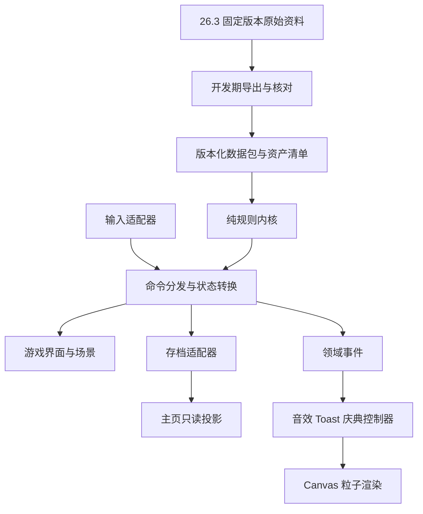

# 总体技术架构草案

日期：2026-10-20。状态：建议方案，等待用户审核；本文没有授权开始实现。需求依据及历史冲突见 [需求核对](requirements-audit.md)，阶段门槛见 [开发路线](development-roadmap.md)，外部依据与待确认决策见 [决策记录](decisions-and-research.md)。

## 1. 架构目标与范围

做一个可在 GitHub Pages 运行的静态生日网页：Vincent 在四个固定场景收集并解锁资源，按 Java 26.3 规则合成蛋糕，在家中桌上放下后观看全页庆典。支持探索副产物、原版容器操作、持续存档，保持项目规模可控。

主要质量目标依次为：需求不丢失、可达规则正确、GUI 行为可验证、原版视觉与声音一致、状态可恢复、模块易审查。没有玩家移动、区块模拟、战斗、红石网络、多人、后端或账号。

## 2. 推荐技术组合

| 层次 | 推荐 | 选择依据 |
| --- | --- | --- |
| 语言 | TypeScript，严格类型检查 | 原版数据、槽位规则与存档迁移需要明确类型边界 |
| UI | React + 普通 CSS / CSS Modules | 目录、配方书、Tooltip、设置状态较多；组件只展示状态与发送命令 |
| 构建 | Vite 静态多入口构建 | 主页和游戏各有实际 HTML，直接访问不依赖服务器重写 |
| 规则内核 | 不依赖 React 的纯 TypeScript | 配方、物品栏、工作站、场景规则可独立验证 |
| 状态接入 | 小型命令分发器、纯状态转换、只读选择器 | 不需要先引入 Redux、复杂 ECS 或通用插件平台；允许以后按证据调整 |
| 场景 | 原版资源构成的分层 2D 固定画面，统一逻辑坐标和热区 | 保留点击场景，不增加浏览器 3D 世界引擎 |
| 原版 GUI | DOM/CSS 布局 + 原版纹理/字体适配器 | 文本输入、可访问性与 Pointer Events 易于组合；不以图片替代可交互界面 |
| 烟花 | Canvas 2D，独立粒子模拟与渲染适配器 | 固定视角下投影原版粒子运动；性能验证不通过才评估 WebGL 渲染器 |
| 音频 | Web Audio API 音频总线 | 原版声音事件解析、并发、音高、时序、音量与暂停可集中管理 |
| 存档 | localStorage + 版本化运行时校验 | 两入口同源共享，无服务器；小规模状态适合 JSON |
| 测试 | Vitest 类单元测试 + Playwright 类浏览器测试 | 纯规则、真实指针/键盘、截图、子路径与存档分别覆盖 |

上述是本轮选型建议，版本号和锁文件在获准实施时再核实固定。本轮不安装。先不加入拖放库、动画库、音频库；原版多按键拖动不等同 HTML 原生拖放，必要行为更适合统一 Pointer Events 状态机。

## 3. 模块与依赖方向

原版数据在开发/构建期规范化，运行时不请求第三方配方服务，不下载 JAR，不引用社区实时主分支。内核不读 DOM、音频或 localStorage；所有时间、随机数与外部输入通过适配器传入。

| 建议模块 | 负责 | 不负责 |
| --- | --- | --- |
| data / vanilla | 原版 ID、组件、标签、配方、燃料、声音、GUI 描述、版本清单 | 用户进度、场景可采集权限 |
| content | 四场景定义、主线目录顺序、生日配置、本地化资源 | 重新发明原版配方 |
| domain / items | 解锁及首次顺序、物品身份与堆叠等价性、装备适用性 | 拖动像素坐标 |
| domain / inventory | 槽位约束、临时组、光标、交换、均分、快速转移 | 资源经济、音效播放 |
| domain / recipes | 匹配、配方书发现/可制作查询、剩余物、可达闭包 | 工作站页面布局 |
| domain / stations | 工作台、熔炉、高炉处理器与实例状态 | 背景纹理与网络请求 |
| domain / scenes | 自然节点、种植、工具判定、放置策略、软锁检查 | 世界生成或实体 AI |
| application | 命令事务、事件、恢复流程、只读选择器 | 在 React 组件里散落规则 |
| persistence | 校验、迁移、保存、备份、跨页同步、写入冲突控制 | 自行授予物品或重播演出 |
| input | 键鼠/触控适配，焦点、组合键、拖动与双击识别 | 判断配方和合法燃料 |
| presentation | 页面、原版 GUI、Tooltip、Toast、场景图层 | 修改持久状态字段 |
| effects | 声音事件、粒子、庆典时间线 | 为演出添加可采集材料 |

后续目录建议是上述职责的映射，不需要提前建出所有空目录。避免主页静态导入整个游戏内核与烟花数据包；共享仅包括本地化、生日配置、存档读取与桌面展示所需资源。

## 4. Java 26.3 数据与资产管线

### 4.1 版本锁定

本轮已从 Mojang 官方清单确认 26.3 为 release，官方发布说明标示 2026-09-15。版本元数据列出 client/server 下载项而无旧式映射下载项；Fabric 同版本说明采用无混淆原始名称。以该版本实际构件为行为基准，不为迁就旧教程换用旧版 Yarn。[版本与命名依据](decisions-and-research.md#2-本轮核实结果)

建议未来 vanilla-lock 清单记录：游戏 ID、版本元数据 URL/SHA-1、客户端与服务端构件校验值、资产索引 ID/URL/校验值、导出器版本、规范化数据哈希、使用的命名空间、数据/资源包格式。下载校验值与项目生成物哈希分别保存；不将“最新版本”别名写进正式构建。

本轮只读了清单/元数据，尚未下载或导出 JAR，没有宣称已核对全部物品、快捷键或烟花实现。

### 4.2 数据来源分工

| 内容 | 首选证据 | 开发期规范化产物 |
| --- | --- | --- |
| 配方、标签、相关进度发现条件 | 同版本内置数据包、注册表及必要生成报告 | recipe、ingredient、tag、discovery 数据 |
| 物品堆叠、装备、工具、燃料 | 同版本注册表与默认组件，必要时只读参考实际代码 | item definition、槽位/工具能力、fuel profile |
| 方块掉落 | 内置掉落表、正确工具及相关标签/组件 | 场景允许来源的 harvest profile |
| GUI 布局与操作 | 同版本实际客户端 + 只读代码核对 | 布局指标、输入真值表、参考截图 |
| 物品图标、方块、模型、字体、GUI 精灵 | 客户端资源及其依赖 | 所需闭包资产、图标渲染结果、字体指标 |
| 声音 | sounds 定义、版本资产索引及对应音频对象 | 事件到变体、权重、音量/音高等参数的映射 |
| 粒子与烟花 | 原版粒子资源与实际行为 | 精灵帧、形状参数、轨迹/寿命/声音时序核对表 |

数据并不都存于配方 JSON；工具规则、默认组件、容器优先级可能必须从运行报告或实际实现提取。不能仅抄第三方静态表。若需要运行游戏生成报告或额外工具，先在获准阶段说明实际运行环境；这些属于开发工具，不进入网站运行时。

### 4.3 导出与资产处理流程

1. 固定原始构件与索引，并校验来源。
2. 解析同版本数据；展开嵌套标签、识别组件和配方类型，保留原版 ID 与来源路径。
3. 依据四场景采集定义计算可达项，生成配方/物品/资产依赖闭包。
4. 对照实际游戏抽样验证高风险条目，再生成仅含项目所需内容的运行数据包。
5. 原始 JAR、反编译参考与临时截图留在开发环境；运行包不包括这些文件。已确认可分发的资源才进入站点资源目录。
6. 对生成物进行可重复性、遗漏依赖、缺图、缺声音、缺本地化和体积检查。

图标不能假设所有物品都有一张 item PNG：方块、模型、父模型、贴图变量、色调、透明度、动画、多层物品、特殊渲染均需处理。建议优先开发期按原版模型生成所需图标；GUI 用原版精灵与拉伸规则；动画材质保留帧元数据。字体需处理字形来源、宽度与阴影，不仅选择一个“像素字体”。

场景建议用同版本原版资源/实际游戏制作固定构图：静态背景与原木、矿石、蛋、工作站、小麦、蛋糕独立分层。禁止将可移除原木等烘焙在背景里导致采集后残影。先用一个场景局部验证遮挡、缩放、热区和工作站替换，再制作四幅完整场景。最终画面生产方法是待审技术决定。

### 4.4 使用与分发门槛

为各资源类别记录来源、使用方式、可分发依据、需署名/声明内容与未决问题；字体、音效和音乐分开检查。[Mojang 使用指南](https://www.minecraft.net/en-us/usage-guidelines)与 [EULA](https://www.minecraft.net/en-us/eula)并非对任意网站资源重新分发的统一授权。本轮不作最终许可结论。

优先验证可合法使用的原版资源途径；未解决的类别阻止该类资源进入正式构建，不默认替换为自造像素图或声音，不以私有仓库/非商用推断免责。完整 JAR 或整套游戏资产不会作为静态包发布。网站声明需求在阶段 P1 核实，原版一致性目标保持不变。

## 5. 状态模型：无限物品与原版容器操作

### 5.1 四类状态

| 状态层 | 字段概念 | 保存策略 |
| --- | --- | --- |
| 永久解锁 | unlocked item IDs、首次获取序号、已发现配方 IDs | 保存；没有全局库存数量、耐久 |
| 持久世界 | 场景工作站实例/位置/朝向、种植、生长进度、蛋糕放置事实 | 保存；自然补货不覆盖 |
| 交互载体 | 九格快捷栏、装备/副手、工作站输入/燃料/输出、合成格、光标 | 临时数量；快捷栏/装备/工作站保存，光标与开关界面不保存；个人合成格的退出策略见下文 |
| 运行表现 | 当前屏幕、拖动经过槽位、hover、声音、粒子、Toast | 内存；加载不重发全部通知 |

永久解锁是唯一物品获取真相。将物品移到光标、快捷栏、装备、工作站，或清空这些位置，都不改动解锁集合。主线顺序是配置，不约束实际游玩顺序；副产物用稳定递增序号而非时钟排序，重复获得不产生新目录条目。

### 5.2 物品、临时组与槽位

- **ItemKey**：原版 namespaced ID + 需要支持的组件身份。不同组件物品不自动合并；若可达特殊配方产生新组件变体，在闭包报告中明确处理。
- **展示目录**：无限复制源，无 count；未解锁仅可查看 Tooltip，所有鼠标/快捷键复制路径都须被禁止。
- **交互组**：ItemKey + count，count 为正整数且不超物品与槽位上限。只用于取放、均分、拆半、复制、交换和视觉。
- **槽位描述**：类型、容量、输入/输出权限、合法物品判定、来源是复制还是移动、快速转移目标及其优先级。
- **装备槽**：使用目标版本装备组件判断对应位置，不接受不适用物品；右键装备以对应槽为空为前置。

光标、合成格、容器临时计数是本轮提议的兼容层，须审批。持久目录无计数；不新增会消耗的“普通背包”。工作站下方的背包区域继续展示无限目录/快捷栏适配；不偷偷加入第二套有限库存。

从目录取物复制，从临时组取放则按原版移动；加工/场景使用另有“保留输入”规则。这区分交互组的移动和资源的消耗，不要求普通左键取放自动复制一切。

本项目没有普通有限背包，工作站 GUI 下方的无限目录也不能作为输出堆叠的接收容器。因此建议结果快速转移只写入合法快捷栏（及原版适用的其他真实接收槽），不向目录累加数量；目录复制到工作站的 Shift 行为则遵循该站输入/燃料优先级，并受接收槽容量约束。这是必须在 P1 明确的项目适配，不能直接照搬原版生存背包的索引范围。

### 5.3 命令、事务与事件

输入先变成语义命令，例如取放槽位、快速移动、完成配方、与资源交互、放置工作站、放置蛋糕、重置。命令先检查上下文和权限，再一次性产生新状态及事件。UI 不直接改字段。

关键不变量：

1. 除重置/显式存档迁移外，解锁只能增加。
2. 未解锁物品不能通过数字键、中键、配方书或旧存档越权生成。
3. 所有计数受各槽位容量限制；装备合法；输出槽不可当输入。
4. 合成、熔炼、采集使用、放置不减少永久解锁，不损耗工具。
5. 拆半、移动和合并不能修改来源目录，原版要求移动的临时组不能无故复制。
6. 同一次获取不重复写首次顺序，不重复弹物品解锁 Toast。
7. 首次桌面放置与完成标记在一个事务中发生；同一动作不能连续启动多场演出。

领域事件与持久事实分开：ItemUnlocked、RecipeDiscovered、CakePlaced 等仅在新命令产生时发布；读档恢复不用重放事件历史。

### 5.4 无限规则下的有界操作

- 手工摆格和配方书填充都从已解锁项复制，不要求目录拥有“3 桶牛奶”的总数量；配方每个占用格必须存在。
- 提议普通取合成结果按原版产物 count 生成临时组并永久解锁，配方输入仍保持。Shift 取结果以目标槽位剩余容量为界，不能使用“直到材料用完”循环。
- 提议鼠标/容器处计数只限制本次摆放或移动，材料可随时从目录复制；不能变成实际资源门槛。
- 剩余物（如奶桶对应空桶）解析自原版规则。由于输入不消耗，不能用剩余物覆盖仍存在的奶桶；已经解锁的剩余物可由目录取出。可达的全新剩余物需纳入产物与解锁规则，具体展示在行为合同中明确。
- 输出满时停止继续填充，等待领取；不无限累计不可见数量，不因重复产出刷无限 Toast/经验声。燃料/输入可移除，处理器按同版本语义停止或保留计时，经过适配的部分列入测试。
- 建议关闭个人合成界面或切换页面时清除光标和个人 2×2 临时填充；已解锁来源随时可重取。放置工作站的输入/燃料/输出保留，拆除时清除该实例，不取消任何物品解锁。此退出策略仍待审批。

## 6. 配方、配方书与可达性

### 6.1 匹配与加工能力

统一原版配方描述，但按加工类型选择处理器。支持有序配方的允许偏移/镜像、无序配方的多重集合匹配、物品/标签/组件条件、原版结果数量与剩余物。2×2 无法容纳的形状不得在个人合成完成；3×3 不将“图案完整占满”误作必需。

普通 crafting、smelting、blasting 是必须覆盖的能力。对 special/dynamic/component 等类型先报告其输入在本项目是否可达，再决定需要的处理器，不能仅支持两种 JSON 格式后宣称“全部原版配方”。未识别且可能可达的类型使数据验证失败，回到阶段审查。

切石机、烟熏炉等方块本身只要配方材料可达就可合成；其功能按用户的功能链边界判定。没有获准的工作站处理能力不加入可达加工集合。不能因此漏掉普通工作台中可制作的相同产物。

### 6.2 可达闭包

离线计算“项目可达集合”，与运行时“Vincent 已解锁集合”分开。

1. 场景定义列出原始来源及能力条件：原木、草掉种子、甘蔗、鸡蛋、石头正确采得圆石、矿物掉落、奶牛挤奶、预耕地种植收获。
2. 从无前置的来源起步，逐步加入可构造的工具、工作站及合法燃料。
3. 某配方所有材料约束可由当前集合满足，且对应工作站确实可制作/放置/使用，才加入其结果与可获取剩余物。重复格数是布局条件，不是库存数量门槛。
4. 新工具开启新的采集来源；新产物可能是燃料或可熔炼输入；反复迭代到不再增加。
5. 保留每个条目的至少一条可执行来源证明，避免高炉依赖平滑石、平滑石依赖熔炉等循环被误当成起点。
6. 输出全部可达物品、配方、燃料、熔炼回收、工作站、能力、资产及不可达原因。对每个可达材料组合的配方都做覆盖核查。

源集合先建议一个原木树种，避免无依据扩展全部木材系列；树种与甘蔗位置由场景定稿批准。背景泥土、水、树叶不因可见而成为来源。是否支持斧头剥皮等额外世界变换，要逐条映射现有交互对象后审查，不随意添加或静默省略。

### 6.3 工具与原版参数

“正确工具类型”和“是否满足获取掉落的条件”独立判断；无需工具破坏也可能没有掉落。根据 26.3 实际标签/组件形成能力测试，不按木→石→铁→金的简单数字排序。工具存在但未选中不自动生效，不添加自动换最佳镐。

随机掉落的随机数可注入以便测试，但实际概率是否简化须审批。树、草、矿物破坏后自然层变化；选错工具破坏矿物仍可借场景补货恢复。

### 6.4 配方书

三类状态分别为：全局可匹配配方、配方书已发现、当前工作站可填充。熟悉原版的玩家可以手工完成尚未发现的正确配方，不能把发现状态当强制解锁门槛。

推荐优先移植适用的原版物品获取/进度发现触发，并将永久解锁动作映射到“获得物品”；无法在固定场景触发且会妨碍查询的规则列出适配项供审查。备选是按材料发现；不在本轮默选备选。配方书只查询项目可达配方，不展示无钻石来源的钻石配方。

界面应包含原版分类、搜索、分页、可制作筛选、变体轮播/展开、幽灵配方、填充及 Shift 行为；具体列表从 26.3 核对。搜索同时覆盖当前语言名称及稳定物品 ID；文本输入时游戏快捷键停用。无限目录下筛选按材料是否解锁和槽位形状判断，不按临时总数量制造“不可制作”。

## 7. 工作站模块

工作站由四部分组合：静态定义、场景实例、纯处理器、GUI 适配器。定义列出槽位、支持配方类型、计时/燃料解释方式、快速转移优先级、可接受面向；实例用稳定 ID 标识，切场景时不依赖 React 组件存活。

| 设备 | 必须处理的行为 | 差异边界 |
| --- | --- | --- |
| 个人 2×2 | 合法配方、临时填充、结果领取、配方书 | 非场景工作站，不需放置 |
| 工作台 | 3×3、原版结果、配方书、Shift/数字键等 | 先放置，再右键打开 |
| 熔炉 | 输入/燃料/输出、火焰/箭头、所有可达 smelting、回收 | 接受原木等合法输入，不能只烧铁 |
| 高炉 | 对应 blasting 数据、GUI、可达矿物/装备加工 | 不接受仅熔炉可烧的原木；速度按 26.3 数据上下文计算 |
| 漏斗（条件范围） | 自身 GUI/槽位、指向、侧面接受规则、转移/抽取及冷却 | 仅在放置评估批准后实现；不是给熔炉复制一份输入按钮 |

26.3 的燃料通过 cooking_fuel 组件描述，速度还涉及上下文数值提供器；熔炉与高炉配方 cookingtime 可以相同。导出器应解析实际 fuel 和上下文速度，内核依据它们推进；不把高炉原数据先减半又叠加速度系数。[官方技术变更](https://www.minecraft.net/en-us/article/minecraft-java-edition-26-3)

燃料临时项不被资源消耗，但仍展示原版燃烧周期；短燃料在周期到期后从仍存在的无限燃料引用继续起燃，允许积累加工进度，不能因为单根木棍不够完成一次就禁止。燃料时长、速度和余留物规则需与无限适配分别记录。

建议连续加工在输出容量范围内运行；结果在首次实际领取时解锁，和“只摆出配方还没取得产物”一致。漏斗若获准，成功转移至合法目的槽的首次产物也视为取得。加工完成但未领取的结果保存于实例，刷新可继续领取。结果解锁时机与退出策略在阶段 P1 行为合同中交用户定案。

活动工作站用统一时钟推进，离开场景不销毁实例。建议离线暂停，重新进入时从存档剩余进度继续；不按关闭网页经过的天数堆积产物。切换浏览器后台后的推进/暂停与离线策略一致，避免大量补帧。种植采用同一策略但自己的短阶段时长。全站设置暂停如何影响时间需明确，不照搬完整世界 tick。

若批准漏斗，其转移只搬临时组，不消耗永久解锁；传输必须有方向、槽位接受规则和有界容量，禁止将输出无限回灌输入导致无穷循环。额外测试涵盖顶部输入、侧向燃料、下方输出及目标移除、输出满、多个连接竞争等实际重合行为，不扩展红石或箱子网络。

## 8. 场景、放置与补货

### 8.1 四场景内容合同

| 场景 | 可交互来源 | 持久层 | 特别约束 |
| --- | --- | --- | --- |
| 平原 | 树干原木、草；建议甘蔗在水边 | 工作站放置 | 地表、树叶、水默认装饰；甘蔗最终位置待确认 |
| 矿洞 | 石头、煤矿、铁矿 | 工作站放置 | 石头掉圆石、铁矿掉落按目标版本；错误工具不得授予正确掉落 |
| 农场 | 预耕地、小麦、牛、鸡旁蛋 | 作物与工作站 | 牛用桶交互；不杀动物、不喂鸡，不强制锄地 |
| 家 | 工作站、独立桌面蛋糕槽 | 工作站、完成桌面 | 蛋糕不受普通工作站布局策略影响 |

建议桌面操作沿用左键采集/拆除、右键种植/挤奶/放置/打开。需要破坏的点击是否有短破坏动画在体验阶段定稿；不引入原版长按挖掘等待作为新门槛。

### 8.2 分层状态

- 场景定义：背景、热区、逻辑坐标、自然节点模板、放置区域、导航、蛋糕槽。
- 可再生运行层：本次访问已破坏/采集的节点。离开后重新进入恢复模板；首次加载/刷新建议视为新进入。
- 玩家持久层：工作站实例、小麦、桌面完成事实。永远不被自然补货覆盖。

各层使用稳定 ID；资源热区与视觉图层共用坐标变换，窗口缩放不会改变存档位置。显示与点击命中顺序明确；补货遇到持久占用时按所选放置策略处理，不能覆盖已放方块或把资源悄悄删除。

### 8.3 放置方案评估

| 方案 | 实现成本来源 | 原版互动收益 | 结论 |
| --- | --- | --- | --- |
| A：引导槽位，可拆/替换 | 槽位合法性、实例保存、拆换处理 | 保留放置/打开/拆除，布局自由较少 | 当前建议；仍需用户审核 |
| B：固定画面内有限网格自由放置 | 占用/朝向、自然层重叠、遮挡命中、漏斗端口/传输、软锁与布局存档 | 在范围内自由布局及一层辅助 | 有价值的备选，P1 先验证完整增量再定案 |
| C：任意像素或完整体素空间 | 连续碰撞/深度/堆叠、复杂接触关系、多分辨率定位 | 超出固定场景所需 | 不推荐，不借自由放置引入世界模拟 |

有限网格的坐标占用本身不困难，不能声称它必然需要完整 3D 物理。主要增量来自**漏斗容器协议、持久实例拓扑、自然补货冲突和防软锁验证**，不能以“只多一个图标”估算成本。本轮没有实现原型，因此不给虚构工时或断言成本已经测定。

P1 批准后用同一局部场景验证 A 与 B：放下两台设备、拆换、重载、自然节点覆盖、连接漏斗、错误侧面输入、输出拥塞和缩放命中。若 B 只需局部放置策略/连接适配、无需新世界系统，且这些规则有明确可验证合同，应向用户推荐 B 并纳入漏斗；若明显扩展多个核心状态机与测试面，则保留 A。最终选择需记录依据并经审查，不自动沿用历史助手结论。

A 方案在有需要的各场景提供工作台与熔炼槽，至少覆盖平原和矿洞；熔炉/高炉可共用槽并可替换；四场景具体位置及数量待场景定稿。拆换先安全关闭当前 GUI、取消拖动、保存/清除实例状态，再替换，不能把熔炉计时串到高炉实例。

B 方案仅允许批准的功能方块和简单辅助，不能因“自由”开放所有可合成方块；箱子、拉杆、压力板仍不放置。数据结构保留位置/朝向能力即可，不提前开发两套引擎。

### 8.4 防软锁

A 通过布局不变量保证：资源热区与工作站槽分离、导航始终可用、耕地不被占、主线工作站位置不永久丢失、错误采矿可切场景补货、任何拖放不撤销解锁。

B 在确认放置前，根据**假设放置后的**场景占用及可解锁能力做未来可达分析：

1. 永久已解锁的物品作为可无限取得来源，不按快捷栏当前是否清空判断短缺。
2. 纳入未被阻挡且可补货的自然来源、可种植收获来源及工作站可放位置。
3. 用 §6 闭包证明仍能获取蛋糕并放到桌上；无铁锭/粗铁时必须保留可达铁来源和工具路径。
4. 燃料将煤炭、木炭、木材及其他已解锁合法燃料作为替代路径综合判断；不能因为一处煤矿被占就一律拒绝。
5. 避免以“先拆除刚放的东西总能恢复”绕过用户要求的保护；对占住最后必需来源的动作给原版风格拒绝反馈。

只对有限场景、来源和能力图做检查，不求解完整 Minecraft 世界。布局不变量的证明与有限状态/属性测试结合；不得宣称常规端到端冒烟测试已穷举全部游戏状态。

## 9. 输入与 GUI 原版一致性

GUI 模块以槽位协议复用操作，而非每个组件各写一套 onClick。输入状态机至少区分空闲、持有、候选双击、左右/中键拖动、快捷键修饰、取消。跨非法槽、松键在界面外、窗口失焦、打开菜单、调整窗口时结束或取消拖动，避免“粘住鼠标”。

P1 形成的真值表每行包含：界面、起始光标/槽位、输入序列、目标状态、拒绝反馈、原版依据、本项目无限适配、自动测试 ID。覆盖清单见路线 P1/P5。

必须覆盖的核对组：

- E、Esc、1–9、滚轮；场景与容器中同一键的不同含义。
- 左右键取放、奇数组拆半、单个放置、整组移动、左拖均分、右拖各一、中键复制和中拖整组。
- 双击收拢、Shift 快速移动、Shift 双击批量转移及不适用槽位；不能把 Shift 双击当作双击收拢。
- 悬浮数字键、F 副手交换、盔甲槽与手持盔甲右键装备。
- Q/Ctrl+Q 的临时丢弃处理、点击界面外的行为：不生成世界掉落物，不减少永久解锁；具体按重合 GUI 适配。
- 配方结果、输出槽、配方书填充/筛选/搜索/分类/分页及 Shift 行为。
- C/X 快捷栏预设是否属于本项目重合范围须核对；若保留相应创造式 UI 则实现保存/加载与持久化，若未采用该界面要明确不适用依据，不能仅为省事删掉。

原版的生存/创造规则分别标注，目录复制按创造来源，工作站转移按容器规则；适配差异只集中在无限资源、固定场景等明确边界。没有对应世界系统的移动、飞行、命令控制台、调试菜单不在范围。

浏览器只在游戏交互区有焦点时拦截右键菜单、中键自动滚动、滚轮、相关按键；不拦截地址栏、全局浏览器安全快捷键，不依赖 Pointer Lock。搜索和设置文本输入获得焦点时保留文字/编辑快捷键，避免输入 e/q/f 时触发动作。系统无法交付的按键组合列入兼容说明并提供可见替代入口，不假装已完全模拟。

桌面键鼠是建议验收基准。触控可通过点选与操作菜单映射同一语义命令，但是否承诺完整可玩、如何替代中键/Shift/悬浮，待用户确认；不反向削减桌面能力。

## 10. 主页、游戏入口与完成同步

建议两个实际入口：仓库基路径下 index.html 与 game/index.html。主页只展示生日标题、故事、空桌/蛋糕、进入按钮；游戏包含场景和 GUI。场景切换在游戏内部完成，无需为四场景各建 HTML；可用游戏内状态或受控 hash，直接游戏地址仍能正常初始化同一存档。

构建使用部署基础路径，链接、图像、字体、音频与数据加载都经统一 URL 解析；测试同时使用根路径和 /minecraft-birthday-2026/，不写硬编码 /assets 或 /game 导致部署失效。Vite 支持多入口，GitHub Pages 使用真实文件目录访问，无需 SPA 404 跳转技巧。[Vite 构建与部署文档](https://vite.dev/guide/build.html)

完成事实只保存一份 cakePlacement（含完成时间等必要元数据）；家中桌面和主页桌面都是该事实的投影。不另存 homeHasCake，防止两页不同步。

放置流程：检查已解锁且正在使用蛋糕、场景为家、桌面合法 → 一次状态事务记录放置 → 同步保存关键进度 → 发送一次 CakePlaced 事件 → 播放庆典。若浏览器保存失败，内存仍展示结果并明确提示无法持久保存，不能声称已经跨刷新保留。

主页在首次加载、pageshow（包括 BFCache）、重新获得可见性时重读存档，并监听其他文档的 storage 更新；本页命令用内部订阅通知，因为 storage 事件不会发给写入它的页面。[MDN storage 事件](https://developer.mozilla.org/en-US/docs/Web/API/Window/storage_event)

返回主页与重新进入不能清档。建议设置提供返回主页；完成后按钮文案及重播入口待确认。进入按钮点击发生在主页，而游戏是另一文档，不能假定音频激活权限跨页面自动继承，游戏内首次手势仍要初始化音频。

## 11. localStorage 存档与恢复

### 11.1 数据信封

| 数据 | 用途 |
| --- | --- |
| schemaVersion | 存档结构迁移，与 Minecraft 数据版本分开 |
| contentVersion / vanillaVersion | 识别场景定义与原版数据变化 |
| saveId、generation、revision、writerId | 区分游戏代次、修订和写入方，处理重置与陈旧写入 |
| unlocked / acquisitionOrder | 解锁与目录顺序，避免重复和排序漂移 |
| hotbar / selectedSlot / armor / offhand | 临时组布局与装备，全部按当前定义校验 |
| scenes / stationInstances / crops | 玩家变化、设备内容及计时，不存背景像素 |
| discoveredRecipes / recipeBookPreferences | 发现事实与必要显示设置，不把当前 hover 写入存档 |
| cakePlacement / celebrationSeen | 已放事实与演出看完事实分离；不能以是否看完决定桌面是否有蛋糕 |
| settings | 独立键保存建议的语言/音量等，具体项目待定 |

项目 key 包含稳定项目命名空间；同一 GitHub 用户的多个仓库 Pages 共享 origin，URL 子路径不隔离 localStorage。不可用 localStorage.clear() 重置所有站点。[MDN localStorage](https://developer.mozilla.org/en-US/docs/Web/API/Window/localStorage)

### 11.2 保存与校验

普通布局变化短间隔合并写入；解锁、播种、放置、结果领取和重置等关键动作立即保存。pagehide/visibilitychange 作为补充，不能只依赖关闭标签时保存。不要每个渲染帧序列化。

读取顺序为：解析 → 信封/版本校验 → 迁移 → 物品/槽位/场景合法性校验 → 恢复 → 启动订阅和时钟。校验未知 ID、重复首次顺序、数量越界、非法装备、非法坐标、未来时间及破损结构。旧版可迁移则迁移，未来 schema 不覆盖；损坏存档保留原始备份并提供恢复/重置反馈，不静默清空。新的空档不能伪装加载成功。

只保留小型上一份有效快照和必要恢复数据，不做云备份。写入异常保持内存可玩并显示本地化提示；后续用户允许保存时恢复持久化。默认不增加导入/导出或账号同步。

### 11.3 多标签页

主页只读。游戏建议单写入方：具备 Web Locks 时持有同项目锁，其他游戏标签只读并显示进入活动标签/显式接管入口；持锁页退出后释放。能力不足时采用保守的活动会话协作检测与接管，而非宣称 revision 能提供原子 CAS。

Web Locks 需要合适的浏览器与安全上下文；正式 Pages HTTPS 与本地 HTTP 开发环境均须实际验证能力。接管先让原写入方停止并重新读取当前存档，再授予新写入方，不能仅抢锁而让原页面继续提交陈旧内存状态。[MDN Web Locks](https://developer.mozilla.org/en-US/docs/Web/API/Web_Locks_API)

generation 用于重置代次；旧代次游戏收到重置通知后停止写入并重新加载，不合并旧解锁集合把已重置的蛋糕恢复。每次恢复焦点/写入前复核外部版本，配合 storage 消息；localStorage 本身没有事务比较交换，不能仅凭“写前读一次”保证并发安全。锁能力和退化方案在 P3 实测后定案。

### 11.4 时间与重置

推荐种植和加工跨场景继续、网页关闭或后台暂停；保存剩余阶段时间而非依赖后台 setInterval 准确触发。小麦保留原版可见生长阶段，用短固定阶段时间，具体秒数待体验调优；不模拟随机刻。

设置必须有重置。建议二次确认后重建本项目进度、新 generation、恢复空桌、清设备/作物/配方发现/快捷栏/演出状态，保留语言音量设置；是否保留设置及重置后返回主页由用户定案。重置必须通知另一主页/游戏标签，不影响同源其他项目。

## 12. 本地化与用户可见文本

默认英文。项目文本用独立命名空间（如 birthday），原版名称/Tooltip/键位/配方分类优先使用锁定版本语言键；收件人与赠送人等作为生日配置插值，不写进组件。第二种语言文件不等于本轮承诺完成翻译或增加语言选择页。

覆盖主页、标题、故事、按钮、场景名称、物品、蒙版 Tooltip、配方书、设置、声音字幕（若纳入）、存档异常、交互拒绝、加载和庆典。HTML 标题与无障碍标签也外置。不要把英文硬编码放进业务异常再直接显示。

开发/CI 检查缺键、占位参数、死键、原版名称映射和硬编码可见文案；提供伪本地化验证长文本与换行，测试英文布局。原版位图字形渲染与 DOM 的文本可读性/无障碍描述配合，避免只剩不可搜索的图片文字。

## 13. 庆典、粒子与声音

将演出作为独立模块，**早于完整游戏流程验证**。测试入口留在开发专用测试环境，不将未解锁的庆典按钮暴露到正式主页。

五种形状 small_ball、large_ball、star、creeper、burst，踪迹和闪烁组合、颜色与淡出、发射/爆炸/闪烁声音是参数化能力。参考同版本实际粒子初速度、分布、阻力、寿命、轨迹生成和闪烁节奏，再投影到固定屏幕；星形/苦力怕形是粒子速度分布，不画一张轮廓替代。

模拟时间步长独立于浏览器刷新率，随机种子可固定，Canvas 按设备像素比绘制并使用原版粒子精灵；控制并发粒子上限、对象复用和离屏释放。性能降级优先减少同时发射数量和绘制分辨率，保留五形状、踪迹与闪烁能力，不用自制圆点特效替换。

声音适配器解析原版事件变体及其参数；候选事件包括 ui.toast.challenge_complete、entity.experience_orb.pickup、entity.player.levelup 和 firework_rocket 的 launch/blast/large_blast/twinkle。准确 ID、远近变体、播放音高与时序由 P1 同版本核实，不能因历史表中存在就认定本轮验证完毕。

区分普通配方解锁 Toast 与最终进度 Toast；放下蛋糕播放最终演出，合成蛋糕只授予物品。经验声音无需经验等级系统，烟花无需可采集火药系统。背景音乐、祝福定稿、演出时长与自动/手动重播均待确认。

首次游戏内手势解锁 AudioContext、提前加载解码必需音效；被浏览器拦截时显示恢复声音入口，静音不能阻止完成。声音以 AudioContext 时间调度，视觉用同一演出时间线，切换标签/返回时按确定策略暂停和恢复，避免集中补放。[浏览器音频限制](https://developer.mozilla.org/en-US/docs/Web/Media/Guides/Autoplay)

建议刷新不自动重播，若完成但未看完提供继续/手动重播；是否采纳由用户决定。cakePlacement 先持久化，即使演出中刷新仍有蛋糕；播放完才写 celebrationSeen。手动重播不再次解锁、不重复写首次完成、不清档。可评估减少动态效果设置，但不把辅助模式当删减标准演出的理由。

## 14. 测试与验收结构

| 层次 | 自动化重点 | 人工补充 |
| --- | --- | --- |
| 原版证据 | 数据哈希、标签解析、已知原版样例、未知类型失败、闭包来源证明 | 同版本游戏复核，防止预期值和实现来自同一错误导出 |
| 纯规则 | 配方排列/偏移/镜像、燃料/工具、解锁、槽位接受、有限转移、不消耗不变量 | 审查无限规则与原版适配是否清晰 |
| 状态/存档 | 迁移、破损恢复、错误 ID、单写入、重置代次、时钟/随机可控 | 禁用存储、关闭浏览器、再次访问 |
| GUI | 所有真值表输入序列；真实 pointer down/move/up、组合键和输入焦点 | 实体鼠标中键/滚轮、触控板、不同键盘布局与浏览器冲突 |
| 集成 | 全新档主线、偏离主线副产物、替代燃料、高炉、切场景补货/持久、错误工具恢复 | Minecraft 熟悉玩家从头试玩，无开发控制台授予物品 |
| 视觉/声音 | 原版 GUI 截图基准、固定种子粒子、音频事件时序断言、缺资源请求失败 | 同版本画面对照、实际聆听，Toast/烟花/音画同步 |
| 静态发布 | 根/仓库子路径两入口直开/刷新、所有资源无 404、完成主页同步、构建包无内部资料 | 真实 Pages URL、目标设备、首次无缓存加载 |

浏览器测试基准建议 Chromium、Firefox、WebKit；在 P1 确认 Vincent 的实际浏览器后固定交付矩阵。自动化不能用单纯 click() 代替所有拖动/键盘动作，也不能用截图证明声音已正确播放。

有界状态模型或属性测试覆盖无限操作不导致死循环、目录越权和软锁。无需穷举所有九格堆叠排列；对布局保护、能力图与原子命令分别建立不变量，再用关键反例验证。

## 15. GitHub Pages 构建与部署

建议流程：锁定工具/依赖 → 干净安装（后续获准阶段）→ 资源来源与生成校验 → 类型/静态检查 → 数据/规则/存档测试 → 构建 → 对构建产物运行浏览器测试与隐私扫描 → 上传 dist → 部署与真实地址冒烟检查。

仅将明确构建输出 dist 交给 Pages，禁止上传仓库根目录。AGENTS.md、docs、原始讨论、JAR、参考代码、开发测试入口和原始素材缓存不进入 dist；构建清单扫描应验证文本特征与文件路径，不能只靠 Git 忽略规则保护。生产 source map 是否发布在 P1 的资源审查中确认，默认不公开含内部路径/参考源码的产物。

PR/分支验证不触发正式部署；正式发布采用 GitHub Actions 的 Pages artifact 与 deployment environment，构建、部署任务明确依赖。依赖安装和测试任务保持只读仓库权限，部署任务才有 Pages/OIDC 所需权限；实际工作流在获准阶段核对官方 Action 版本并固定。[GitHub Pages 工作流](https://docs.github.com/en/pages/getting-started-with-github-pages/using-custom-workflows-with-github-pages)

私有仓库的 Pages 资格与站点访问范围须在发布前单独核查；私有仓库不等于站点私有，不自动改变仓库或站点权限。本轮不读取账户套餐、不改设置、不创建工作流、不部署。

生成包体积先按资产清单测量，再定预算；本轮不凭空承诺首屏大小或帧率。建议目标为目标桌面设备稳定 60fps，允许降并发保障主线程交互；P2 记录实测硬件、DPR、粒子数量、帧时间与资源大小后冻结可执行预算。后续使用内容哈希资源避免部署后混用旧素材；暂不引入 Service Worker/PWA，以免扩大离线缓存与版本一致性问题。
