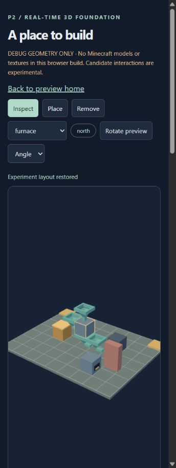
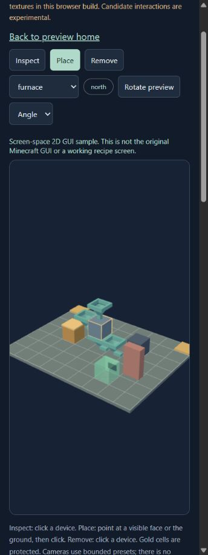
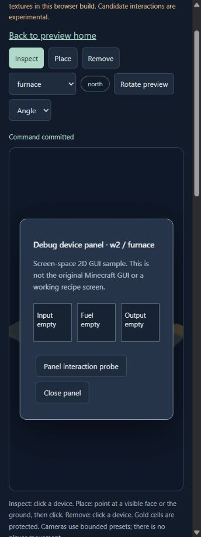

# P2 首轮：浏览器执行与性能记录

日期：2026-10-20。范围见[报告](report.md)和[运行说明](../../experiments/scene3d/README.md)。所有画面来自实际 in-app Chromium，浏览器中没有原版资源。截图保存为工具返回的原始 JPEG 字节；没有用截图替代实时渲染，也没有据截图计算 FPS。

## 1. 环境与负载

Intel i9-12900H / RTX 3080 Ti Laptop GPU，驱动 32.0.16.1714；Chromium 155.0.0.0，WebGL2，ANGLE D3D11 硬件后端。CSS canvas 310×610，DPR=1.25，实际 backing 387×762，Angle 相机，无阴影贴图、外部纹理、原版 GUI、音频或粒子。`textures:1` 是 renderer 内部计数，**不代表加载了一张原版贴图**。没有纯 GPU 时间或显存字节测量。

| 固定负载 | 实例 | draw calls | 三角形 | 几何计数 | 三次实际 FPS | p50 / p95 ms | 各次最大帧间隔 ms |
| --- | ---: | ---: | ---: | ---: | --- | --- | --- |
| 初始布局 | 7 | 38 | 416 | 38 | 239.803 / 239.499 / 239.606 | 约 4.2 / 4.3 | 8.4 / 8.5 / 8.4 |
| 密集布局 | 38 | 179 | 2,044 | 179 | 240.002 / 239.802 / 239.804 | 约 4.2 / 4.3 | 4.5 / 12.5 / 8.4 |

各次实际采样约 10.00 秒，基准样本数 2400/2397/2398，密集 2401/2399/2399，均没有 >33.33ms 样本。每次预热 2 秒，各负载三次，采样时冻结布局操作。原始 intervals 与结果见 [baseline](evidence/browser-baseline.json) 和 [dense](evidence/browser-dense.json)（后者同时保留此前 baseline，密集为 measurements[1]）。

这只是短时初测：高端 GPU、小画布、简单平色模型、接近显示刷新上限，不能区分两负载的剩余 GPU 余量，更不能外推全屏原版四场景。没有冷启动/资源解码、主线程拾取延迟、正式 GUI/烟花联合负载数据；正式预算、目标设备和完整采样协议仍待审。

## 2. 自动浏览器断言

通过页面按钮运行 `browser-checks.ts`，真实浏览器 13/13、0 失败，记录在 baseline 的 checks。预期几何/坐标/面/方向由固定 fixture 给定；CPU 射线与实际 WebGL2 绘制结合验证，不以屏幕截图或固定 FPS 常数代替。B12 在同一 renderer 中 12 次增删后，`renderer.info.memory.geometries` 回到基线。

子路径 `http://127.0.0.1:4179/minecraft-birthday-2026/game/` 实际直开后，同样 13/13；随后刷新回到 7 实例、WebGL2=true。证据：[subpath-browser.json](evidence/subpath-browser.json)、[subpath-reload.txt](evidence/subpath-reload.txt)。独立根主页的实际 AX 见 [home-browser.txt](evidence/home-browser.txt)；首页 JS 依赖闭包另有构建图审计，不能仅根据页面自称没有 Three 就下结论。

## 3. 物理输入、存档与释放

[physical-smoke.json](evidence/physical-smoke.json) 保留 11 条原始记录，其中 10 条断言为 true，1 次坐标误点为 false。它们是实验操作序列，并非 11 个独立自动化测试；其中首次 Load 发生在未成功拆除之后，只证明幂等读取，不能算作拆除后恢复。真正的成功拆除后恢复由后面的独立记录证明。

| 序列 | 观察到的实际结果 |
| --- | --- |
| Inspect 点击三维炉 | 最近命中 w2，顶部法线 +Y，selected=w2，屏幕 panelOpen=true |
| 点击面板探针按钮 | pointerEvents 保持 1、actions 保持 2，没有到达世界处理器 |
| Place 移动/右击地面 | 射线命中 ground，candidate=[2,0,2]；原 7 实例不变，三维预览可见。右击只为保留悬浮预览截图，不是产品输入定案 |
| 左击确认 | 新独立 w8/furnace/[2,0,2]/north，8 实例 |
| Rotate selected / Save | w8 改 east，布局写入独立实验 namespace |
| 第一次 Remove 点击 | **误点地面 [1,0,1]，8 实例未减少**；保留失败记录，不归咎实现 |
| 校正截图显示比例后 Remove | 真实命中 w8，法线 +Z，剩 7 实例 |
| 再 Load | 同一 ID w8、[2,0,2]、east 恢复，8 实例及四条派生邻接恢复 |
| Restart renderer | 旧 adapter disposed=true，385 自有几何 created=released，sharedMaterials=0、retainedDeviceMappings=0、canvasConnected=false |
| 点击重建后的真实画布 | w2 再打开面板，pointerEvents 从 4 到 5，只处理一次；布局仍 8 实例 |

生命周期原始记录见 [browser-lifecycle.json](evidence/browser-lifecycle.json)。这里证明显式销毁/创建和样本资源平衡，不证明驱动上下文意外丢失的自动恢复、长期 GPU/JS 堆没有泄漏，或真实纹理缓存已验收。GUI 占位面板不是正式无障碍/焦点/快捷键实现。

## 4. 实际截图

下列截图只展示调试三维几何和最小二维 GUI；原版模型仅离线探针，不能据此标为 browser 原版通过。

## 5. 尚未验证

原版 textured browser 视觉、完整原版 GUI/快捷键、透明纹理点击穿透政策、多 DPR/桌面全宽/Firefox/WebKit/移动设备、真实客户端对照、加载/解码/拾取延迟、连续操作时延、自然补货与完整软锁、多页正式存档、原版粒子音频及联合性能、自动上下文恢复均未验证。所有本轮成功只适用于上面的固定环境和实验简化。
