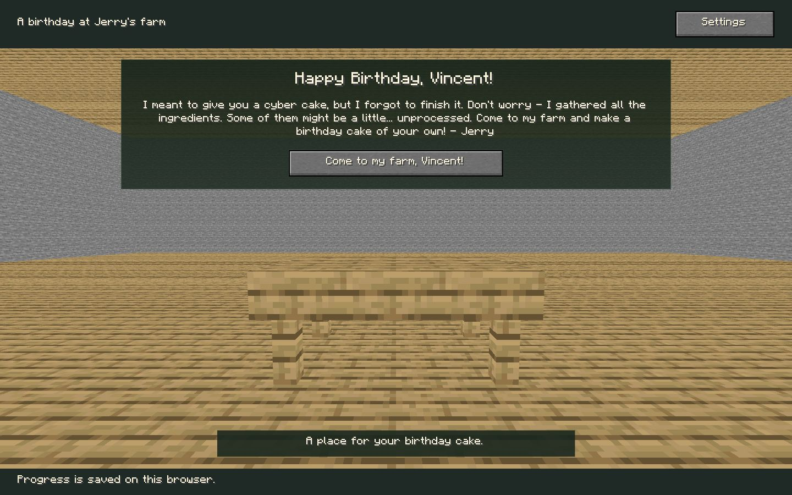
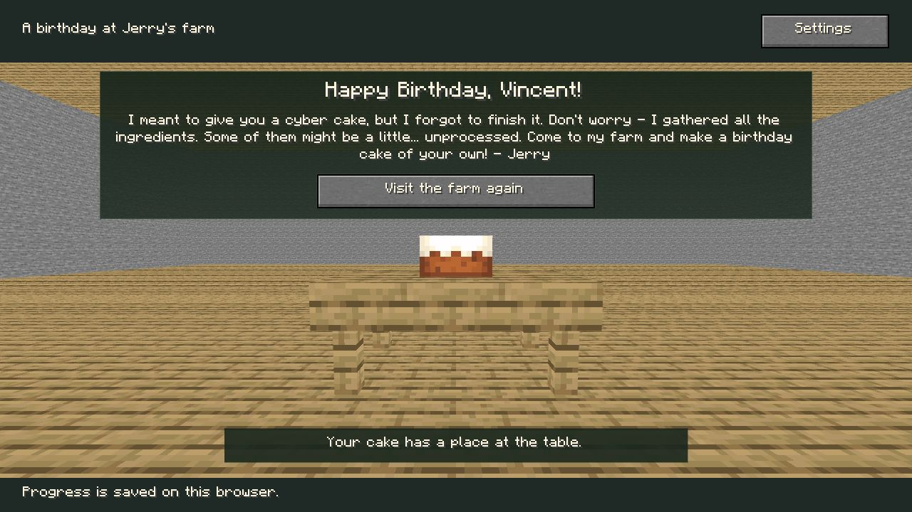
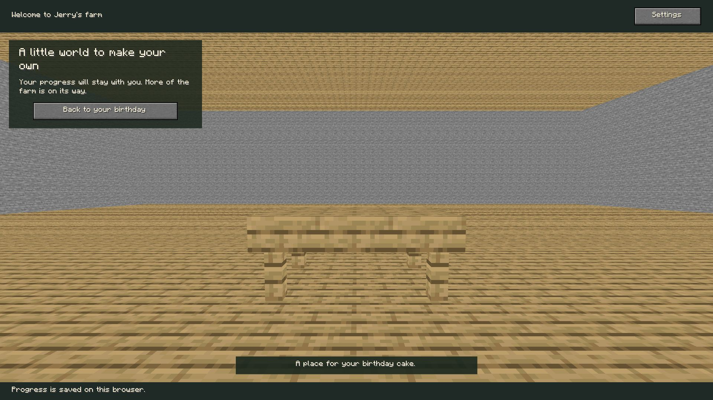

# P4 浏览器与构建记录

日期：2026-10-21。Windows，ChatGPT内置Chromium 155，WebGL2/Three r186，Node25.2.1/npm11.6.2。全部为本机执行，无Java客户端启动、公开部署或其他引擎/低端设备测试。此前P1/P2/P3记录不覆盖。

## 真实画面与尺寸

通过浏览器视口能力设置实际CSS尺寸，逐页读取innerWidth/innerHeight核对后截取完整视口，不改变网页缩放。最终12项记录在[layout-matrix.json](evidence/layout-matrix.json)，最终截图不是P1二维诊断界面。桌面DPR约1，窄屏约1.000000015；前期状态回归环境DPR1.25，不能当作完整DPR矩阵。

| 实际视口  | 空桌/蛋糕/游戏          | 页面尺寸                   | 观察                                                             |
|-----------|-------------------------|----------------------------|------------------------------------------------------------------|
| 1920×1080 | 三项原版资源26.3、ready | 1920×1080                  | 全宽房间、正面桌面、无准星，桌面/蛋糕居中                        |
| 1440×900  | 同上                    | 1440×900                   | 真实透视/遮挡，桌面保留厚度，蛋糕贴合                            |
| 1280×720  | 同上                    | 1280×720                   | 最终紧凑间距下蛋糕完整，按钮可见，无页面溢出                     |
| 390×844   | 同上                    | 375×1072（15px纵向滚动条） | 无横向溢出，文字换行、按钮可用；自然向下滚动，非桌面空间验收替代 |

空桌与游戏72 draw calls，蛋糕78；这只是当前静态展示的绘制计数，不是正式四场景/联合庆典性能验收。真实环境4836个基础立方体实例加桌面/蛋糕，原版几何/UV不通过拉伸伪造。事件驱动渲染，无永久空转RAF。尚未测此展示在目标低端机器的连续帧分布。

## 浏览器执行与规则加载

- 普通dev4183的生日按钮进入独立/game/，back/forward保留同代次/同revision/ready，真实原版画布重建可见；[记录](evidence/navigation-and-gui.json)。没有观察到可确认的BFCache命中，不把前后导航等同BFCache专项通过。
- 原设置窗口打开，真实右键点击背后的3D画布，窗口保持打开且selection为空；Done关闭后，相同右键短击选中真实桌子，未改变存档。没有把短击测试冒称右拖实机测试。
- 4184隔离fixture与另一主页标签执行进度重置→空桌、测试命令放蛋糕→有蛋糕、刷新保持；[命令记录](evidence/completion-regression.json)。原P3格式仍可读，设置保留；玩家正常页没有授物/一键完成入口。
- [规则查询记录](evidence/browser-rule-load.json)：普通HTTP数据加载/哈希验证，113项/112配方，石镐铁矿→粗铁、成年牛奶桶事实、木棍100tick/普通加工200tick、蛋糕1个及3个独立桶剩余物。读取前后存档原始字节比较为true；未授物、未发现配方。
- [长文本记录](evidence/long-layout.json)及long-*.jpg：1440/1280/390视口下所有主文字/按钮scrollWidth不大于clientWidth，长单词可断行、没有截断故事。故意给每个标签添加长句导致页面纵向增长，允许滚动；不声称这种压力样本是最终美术版式。
- 普通root和Pages两套静态preview分别访问主页/game，实际WebGL2画布与原版字体正常，资源26.3、save ready、邀请路径正确，所采控制台无warn/error；[结果](evidence/preview-results.json)。纯规则查询仍放隔离fixture，正式页面无测试菜单。

## 自动化与构建

| 检查                   | 结果与日志                                                                                                                              |
|------------------------|-----------------------------------------------------------------------------------------------------------------------------------------|
| TypeScript strict      | 通过，[typecheck](evidence/typecheck.log)                                                                                               |
| 正式应用单元           | 38通过，0失败/跳过，[unit-tests](evidence/unit-tests.log)                                                                               |
| P2原实验回归           | 48通过，0失败/跳过，[p2-regression](evidence/p2-regression.log)                                                                         |
| 全数据/源码/执行链     | 2042分类、112执行、113证明/18步链，通过，[data-verify](evidence/data-verify.log)                                                        |
| 同输入重复导出         | 7个JSON及状态注册表逐字节一致，[reproducibility](evidence/reproducibility.json)                                                         |
| 根/Pages构建与产物审计 | 均通过，[root](evidence/build-root.log)、[pages](evidence/build-pages.log)                                                              |
| 实际HTTP产物           | 2通过、0失败；每套114原版资源/清单＋2规则文件字节一致；内部资料、fixture、JAR及全catalog/coverage为404，[HTTP](evidence/http-build.log) |

普通网站仅含双入口、运行模块、原版资源及必要规范化规则。未把完整客户端、个人路径、研究日志、临时目录或完整数据目录复制到网站。无需MC_LOCAL_SAMPLES、开发专用加载按钮或本机Java运行。

## 发现、修正与未验证

保留[早期1280遮挡图](evidence/pre-spacing-cake-1280.jpg)：生日面板曾覆盖蛋糕上沿，已调整短屏间距，最终截图单独保存。保留startup-unconfirmed-1920.jpg及startup-observation.json：首次过早观测尚无canvas，不作通过证据，后续等原版draw-calls存在再验。

同时启动普通/verification dev曾出现共用Vite缓存的EPERM；现在按mode分离cacheDir，两服务器实际运行正常。一次视口工具设置只作用于最新标签，旧标签未随之变化；最终矩阵改为同一受控标签逐项核对innerWidth/innerHeight，未以裁剪旧画面替代尺寸验证。只读DOM工具不暴露performance对象，未据此伪造资源时序，资源字节由HTTP测试核验。

待人工执行（尚未宣告通过）：

1. 打开4183/game/，右键短按桌子应只选择；按住右键移动超过6CSSpx，摄像机原地转动，松开不得同时选中桌子/打开未来菜单。移动不越界，不出现准星/Pointer Lock。
2. 打开Settings，左右拖动、滚轮不得改变场景；关闭后恢复；右拖中切走窗口/标签，返回后不继续拖动或误Use。真实RMB拖动未由当前浏览器工具完成，纯Look阈值/角度/取消单元测试不替代这项。
3. 其他浏览器、真实BFCache恢复、目标低端设备和四场景全部必要对象的允许视角覆盖在对应集成阶段复验。P4基础房间不是正式农场或P7建造范围。
4. 保留P2原人工试听/后台/GUI组合及Java26.3视觉/听觉对照清单；本次未运行Java客户端、不重新宣告试听通过。

## 复现

在app中运行npm run dev，打开4183/与/game/；npm run dev:verify打开4184/ __verify__/index.html，另开4184/观察测试完成状态，使用Read P4 rule data。普通页不授蛋糕。

npm run check、npm test、npm run data:verify、npm run build、npm run build:pages、npm run test:built。实际预览npm run preview（4185）/npm run preview:pages（4186/minecraft-birthday-2026/）。只校验/运行不需要客户端；重导需要同哈希官方输入及已有javap，步骤见数据README。
