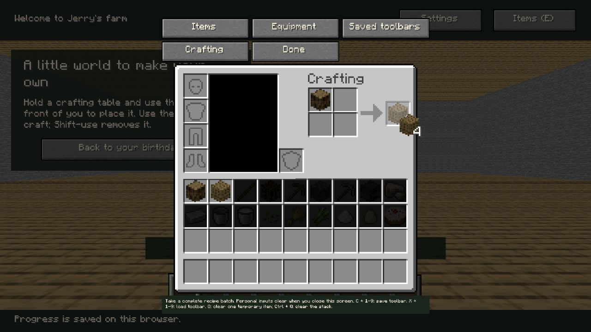
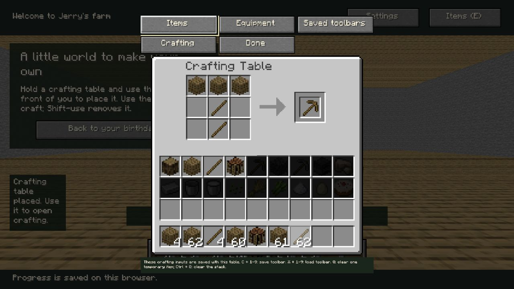
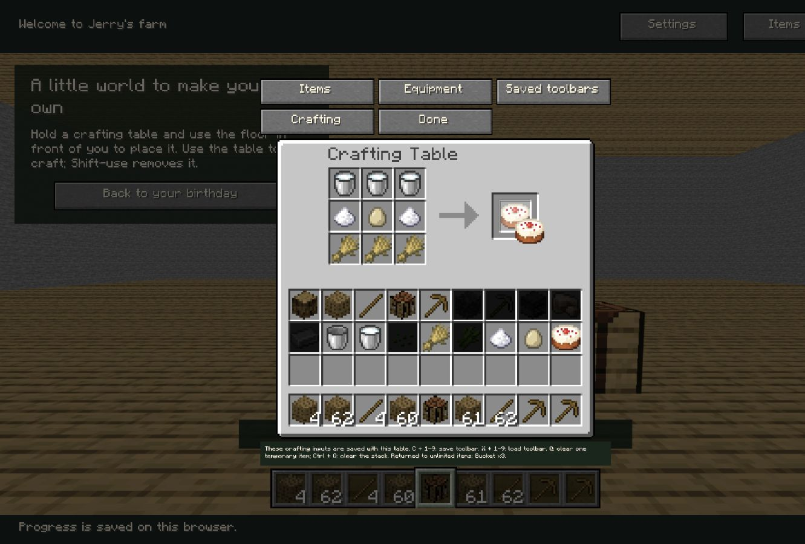

# P6 个人2×2领取与实例工作台3×3交付

日期：2026-10-21。审查基线：`b823bf956449723df3f863c9fd15621d8b289ea4`。用户明确回复“批准完整合同，选择A：目录返还（推荐）”，先批准后实现。完整[D05合同](d05-proposal.md)、[事务/存档契约](storage-crafting-contract.md)为后续会话入口。本次不是完整P6完成，不自动启动炉/漏斗、配方书或P7/P8，不部署。

## 实际功能

- 个人2×2从只读预览升级为领取；正确摆格仍不授物/发现。左/右键各领完整原版结果批次，容量不足全拒绝；数字/F领到可完整容纳的指定快捷格/副手；Shift仅按九格同组件容量有界制作。结果不参与普通SlotRef，中键、拖动、Q/收拢不能制造产物或塞材料。
- 工作台原版176×166屏幕GUI：九输入、真实结果图标/数量、原版ASCII/Tooltip/槽位。下方继续无限目录与九格，不添加有限普通背包。复用P5拖动/槽策略；非消耗合成保留输入数目/组件。
- D05 A：领取提交时返回原版余留事实到永久无限目录；蛋糕返回3桶，已解锁幂等，界面说明返还种类与聚合数量；无临时桶塞格、隐形队列或增长库存。未领/领取失败不返还、不解锁。
- `domain/crafting.ts`只规划原版匹配及完整批次，`state`/`SaveSession`在P3锁内原子执行载体与首次取得。UI不直接改存档，不信任预览的产物ID。首次通知来自新事实事件，重复取得不重复首次事件，不实现D06发现。
- 真实3D工作台按持久ID显示/射线Use开GUI，GUI不随模型旋转；关GUI清页内光标，九输入留实例；刷新/重进恢复；跨标签移除/切场景关闭失效GUI；拆除删除内容，不偷偷领取预览。原先个人四格关闭规则不套用到实例九格。
- 默认模型/材质、113图标、字体/原版GUI继续普通Git/build加载，无外部缓存限制。`crafting_table.png`原已在P2资源集中，本次增加到CatalogueArt的原版依赖清单；**没有新增替代图片/依赖或完整客户端**，运行资源仍478文件（含3清单），catalogue原始依赖增至402。

## 最小场景连接的边界

`domain/workbench-region.ts`仅为当前承载房间设置工作台地面操作边界：x=-4…3、y=0、z=-5…2，排除生日桌占地。它是P6设备GUI连接的工程范围，不是P7四场景建造区域，不声称完整方案B放置体验/预览/旋转UI已在正式四场景完成。

玩家持已取得工作台，短右键Use可见合法地面放置；右键设备打开3×3；Shift右键设备拆除。当前放置朝北，已有存档其他朝向继续原版渲染；未新增相机手势。保留第一人称/无准星/自由鼠标射线，右拖原地转向与Use分流不变。最终生日主页故事、正面桌面/蛋糕及宽屏构图未改；本轮游戏承载页增加外置英文操作说明，不把房间称为最终农场。

## 规则与回归

正式检查命令与完整日志均在[evidence/crafting](evidence/crafting/)。最终数量以各日志末尾及最终汇报为准。

| 检查 | 证据及范围 |
| --- | --- |
| TypeScript | `typecheck.log`，零错误 |
| 正式单元测试 | `unit.log`，109通过/0失败；P3存档/并发/重置、P4规则、P5输入与D07回归，加D05批次/失败/实例事务 |
| P4数据/113载体规则 | `p4-data.log`、`inventory-data.log`；113候选物品/112可达配方，不改P4规则或注册表 |
| P2关键回归 | `p2-regression.log`，48通过；不把P2人工项改成已通过 |
| 根路径/Pages构建 | `build-root.log`、`build-pages.log`；478原版资源/清单及2规则文件；无docs/AGENTS/实验/客户端泄漏 |
| 构建HTTP | `built-http.log`，2通过/0失败，两base下入口、逐文件哈希、内部路径拒绝 |
| 实际浏览器 | 下节及`browser-assertions.json`；断言基于保存的浏览器记录，不伪称另一次执行 |

核心新增断言：原木/木板/木棍/工作台/木镐完整执行链；蛋糕三独立桶及不触发完成；2×2尺寸拒绝3×3；同组件/默认耐久归一、上限、未知变体拒绝；6容量只领4、最大九格144批、满槽停止；数字/F不覆盖异物；无通用结果槽捷径；写失败无字节/事件/解锁变更；同布局竞争/同实例内容竞争/重置前排队合成拒绝；实例隔离/场景错误/拆除失效；P5→P6迁移保留布局设置完成；关闭迟到回执不复活光标。

## G21–G30本切片覆盖

| 行号 | 代码/自动化 | 实际浏览器与未验范围 |
| --- | --- | --- |
| G21 | 2×2/实例3×3、P4镜像/偏移/tag/重复格匹配、预览不取得 | 实际原木/木棍/工作台/木镐/蛋糕；不是Java客户端操作对照 |
| G22 | 左右整批、数字/F目标容量与非法结果槽权限、事务失败不授物、A三桶 | 右键4板/蛋糕、左键木棍/木镐、数字5工作台、中键/Q结果不授物；F领取仅规则测试 |
| G23 | 九格容量上界、6空位仅4产物、最多144批；无输入耗尽循环 | 木镐填最后一格及再次满槽拒绝；非人工批量手感验收 |
| G24–G27 | 原版数据及D05炉/漏斗合同已具备；正式加工未实现 | 留后续P6，不列通过 |
| G28–G29 | D06待审、完整配方书未实现；手工匹配不依赖发现 | 留后续P6，不列通过 |
| G30 | D07个人清空/实例持久、失效实例/旧回执/代次拦截 | 实际关/开/刷新/另一标签拆台；实体拖动取消、窗口失焦/BFCache仍待人工 |

## 实际浏览器证据

Windows、内嵌Chromium155。实际DOM与记录：1280×720/DPR1.25，以及1440×900/DPR约1。使用CUA可信鼠标点击（含右/中键）、Shift修饰点击、真实键盘与页面刷新；没有dispatchEvent伪装为实体操作。浏览器由自动化驱动，不等同用户已经人工验收。

1. 隔离4184存档先重置，仅夹具取得原木；后续木板、木棍、工作台、木镐均经正式GUI制作取得。预览时木板锁定；右键得4、原木仍1；木棍4；数字5把工作台完整领到快捷格。`before-receipt.json`、`right-receipt.json`、`wooden-pick-chain.json`、`chain-input.json`。
2. 1280视口短右键地面(900,500)实际放置实例，坐标[2,0,0]、north；右键真实模型(866,450)打开同ID3×3，放3木板/2木棍，木镐预览不先点亮；左领后点亮。`placed-workbench.json`、`workbench-preview.json`与对应PNG。
3. 保存木镐到快捷格后刷新，右键同模型，九输入与实例ID恢复；Shift只填最后一个空格，再Shift显示整批容量不足。中键结果及Q结果不生成光标/额外物品。`refresh-workbench.json`、`shift-full-and-input-gates.json`。
4. 1440视口通过测试专用夹具仅解锁蛋糕原料，**不解锁蛋糕**；普通GUI清工作台旧输入，填9格，预览仍锁定；右领蛋糕1、提示Bucket x3、三奶桶仍在、满九格不改变，主页完成投影false。`cake-preview-1440.json`、`cake-receipt-1440.json`、`cake-returned-1440.png`。
5. 另一实际标签页Shift右键拆台，当前开GUI的1440页面自动关闭、stationId为空、光标/页内四格/结果清空、workbench投影null。永久蛋糕取得不撤销，但从未触发桌面完成。`cross-tab-removal.json`。
6. 普通dev/根路径preview/Pages preview的原版GUI加载与控制台记录另见`built-browser.json`。普通页面没有夹具取得按钮，初始未解锁的合成流程不由页面测试后门代替。

## 本次发现与限制

- 初次单测有旧断言用字符串`crafting`搜索整份JSON，新contentVersion恰含该词；改为检查player精确字段，保留失败日志`unit-initial-legacy-assertion.log`。新增GUI单测夹具漏dataset造成一次失败，补齐夹具，保留`unit-before-harnessfix.log`。
- 初次真实领取：领域保存成功，但SaveSession的“发生持久变化”返回分支漏receipt，UI误报失败且未接回光标。两返回分支现都携带成功回执，新增真实SaveSession首次/重复领取断言，重置隔离存档后从头重新执行并保留上述成功浏览器记录。该故障仅发生在未提交开发过程，不伪称初测全过。
- 切页布局刚变时一次自动化点击打到旧坐标，后续预览定位超时；按新AX/DOM观察重新选定稳定布局后完成，未使用合成事件补通过。宽屏覆盖初次未反映于已有1280页面，记录按实际尺寸命名，1440证据只取实际DOM测得1440/900的页面。一次初始宽屏截图场景未呈现，后续同页实际三维设备拾取和截图已显示；未无证据归因GPU/自动化，也不把初图当视觉通过。
- 实体右拖/中拖、中途Esc拖动、真实窗口失焦、BFCache实命中、跨引擎和Java26.3实机对照仍见[P5人工清单](../p5/manual-checklist.md)，不以本次可信点击或状态测试代替。
- 仅处理当前可达默认组件及已核实修理；未知组件显式拒绝，不宣称完整Minecraft组件/特殊模型一致。调试几何没有取代原版功能。
- 炉/高炉/漏斗加工、配方书发现/填充、D08时钟和正式四场景仍未实现；本次蛋糕物品取得不是最终结局，庆典仍须P8在家桌面放置后触发。
- 构建保留Three.js体积提示；不是本次运行失败，也不把短时浏览器测试当低端性能验收。

## 复现

1. `npm --prefix app run dev` → `http://127.0.0.1:4183/game/`；正式双入口/原版资源正常加载。E→Crafting为个人2×2。无正式自然资源采集时不伪造完整新档主线。
2. `npm --prefix app run dev:verify` → 4184的`/__verify__/index.html`重置隔离进度、Fixture: unlock log；另开`/__verify__/input.html`操作原版GUI。此测试origin与4183进度分开，夹具不进入普通构建。
3. 从原木配方右键取4板，制作木棍/工作台，工作台放快捷格并选中；Esc后右键桌旁地面放台、右键台开3×3，按原版摆木镐。关GUI/刷新重进核对九输入。
4. 夹具Fixture: unlock cake ingredients仅给五种原料/桶资格；清工作台旧格、摆蛋糕，先核对目录锁定，再领取核对Bucket x3及完成false。另一游戏标签Shift右键拆台，核对失效GUI关闭。
5. `npm --prefix app run build`与`npm --prefix app run preview`；Pages使用`build:pages`及`preview:pages`，地址`http://127.0.0.1:4186/minecraft-birthday-2026/game/`。普通构建不提供夹具或完成按钮。

本次提交后停止等待独立审查；技术上交付本切片不等于用户已审查通过或授权后续业务。
