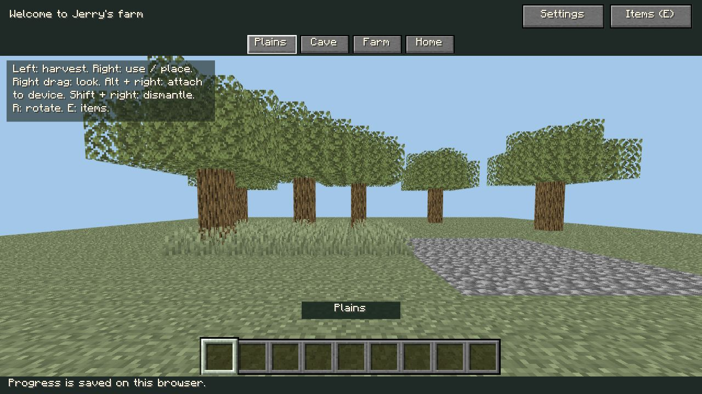
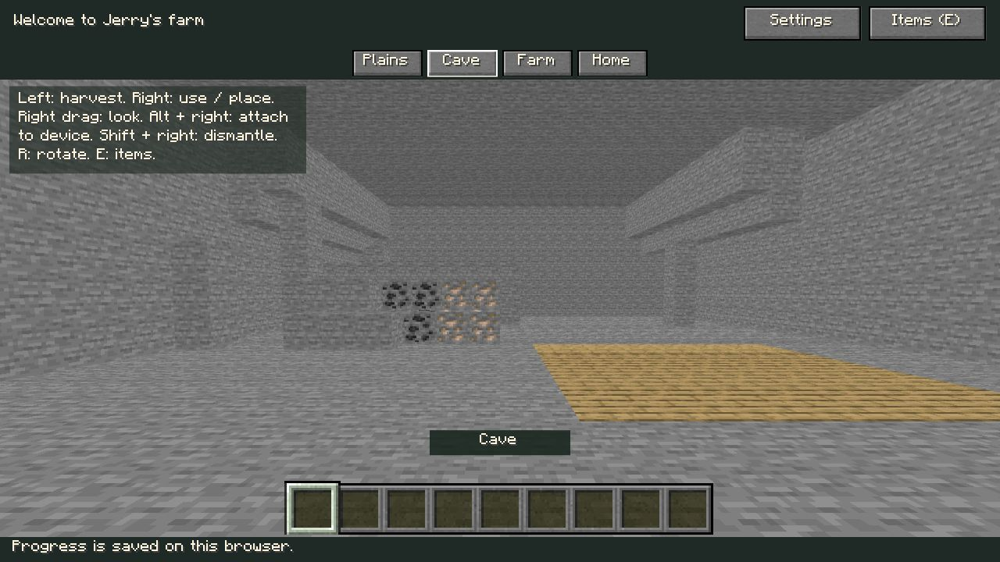
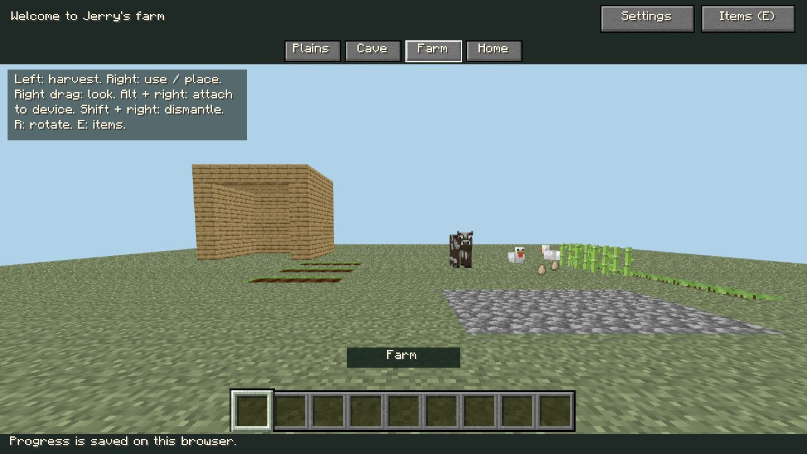
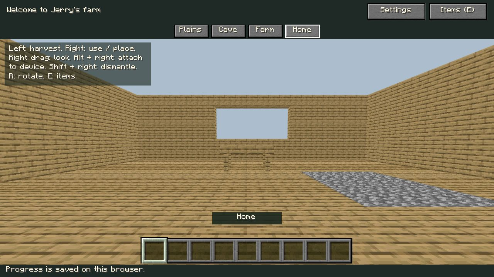

当前续验见[followup-review.md](followup-review.md)：普通页面蛋糕、真实种植、玩家搭链、空间/尺寸与60秒性能已有新增证据。下文保留b39首轮交付时的原始结果和缺项，不将其改写为当时已经通过。

# P7 浏览器证据与缺口

2026-10-22，应用内Chromium/WebGL2；Three0.186.1、Vite8.3.4、Node25.2.1。普通应用4183，独立验证4184；开发服务器的HMR会按正常生命周期关闭个人临时输入，所以操作证据必须在代码稳定后取得。

## 可信执行与画面

- 普通`/game/`新档没有预授物。真实浏览器canvas中心点击触发摄像机射线，原木消失，E目录中Oak Log可用，其余主线仍锁定；不是控制台修改状态。
- 实际点击原版个人Crafting与配方书Oak Planks，正式填充结果为`minecraft:oak_planks x4`。窄屏收书后仍有真实预览。随后可信左键领取，光标4木板、木板目录解锁且save ready，Done后光标/四格为空；见ordinary-planks.json及ordinary-planks-390.jpg。全链和工作站建造尚未形成完整可靠记录，不把纯命令蛋糕测试算作通过。
- 四场景切换通过实际按钮；截图前核对`data-rendered-scene`并等待合成器，完整页面JPEG捕获。早期未等异步存档/合成器的截图不作为验收依据。
- `*-1280.jpg`四场景实际1280×720，`visual-1280.json`记录当前场景/尺寸/draw calls；`*-390.jpg`及`visual-390.json`实际390×844，document.scrollWidth=390，无页面横向溢出。
- `*-1440.jpg`为1440×900画面。1920×1080正式画布实际1920×946、页面scrollWidth1920、资源26.3就绪；该尺寸完整截图报Unable to capture screenshot，**不宣称已取得1920完整截图或四场景完整截图验收**。
- `*-unconfirmed-viewport.jpg`是早期视口设置作用于另一标签造成的1440图像，名称明确标注，不作为1920证据。后续检查同时核对实际innerWidth和JPEG像素尺寸。

## 独立夹具，不是普通页面主线

`/__verify__/world.html`使用正式SceneView/AuthoredWorld/transition和原版资源，仅持有自己的内存状态，不授物到普通应用存档。Dense legal layout构建126个合法坐标实例，Advance240调用权威全场景tick，实际看到输入从上层H进入炉、底部H收到产物；它证明真实浏览器执行了网络/渲染，**不证明玩家已从普通页面搭建这条链**。

早期1280/DPR1.25、360RAF记录见`perf-before-1280.json`：126实例、1,352 calls、34,944 triangles、CPU提交p50 2.5ms、p95 3.2ms，帧p50约4.2ms。这是该机器/短时/夹具记录，不等于普通游戏或低端性能通过。按纹理合并后读取428 calls，保留原模型面。早期连续帧复测遇到HMR/批量动作时序造成记录无效；稳定版本单独触发后取得perf-after-1440.json：330帧p50约4.2ms、p95约4.3ms、max20.8ms，>16.7ms一次、>33.3/50ms零次，CPU提交p50约1ms/p95约1.6ms。时长仅约1.54秒，分辨率/DPR与before不同，不作严格FPS优化因果或长期性能结论。

密集网络早期240tick一次推进约3819.5ms，随后排除空端口及无取得的重复发现求值；CPU/浏览器计数要分别报告，不能用Node计时替代浏览器。Small native connection的真实浏览器240tick记录为17.5ms，network-before/after.json保留有限内容；receiver含1木炭和4木棍，producer含9原木和5木棍；对应network-after.jpg是真实运行截图。cpu-network-fixed.json记录修正后纯Node基准及大步一致性，cpu-network.json保留发现顺序失败。1280×720的perf-after-1280.json保留另一实际结果：330帧p95约11.4ms/max545.6ms，>16.7/33.3/50ms为8/7/5；同时有测试/构建工作，但长帧原因未经trace，不无证据归因。完整长期联合性能仍待补测。

## 工具与人工边界

应用内接口本轮支持语义控件、canvas中心点击、只读状态和截图；自由坐标/实体右拖接口不可用。Windows技能尝试在选定Edge窗口观察时因无法可靠核实当前网址而停止；停止后没有继续发桌面输入，也没有绕过该检查。没有将DOM合成事件称为可信输入，没有人工试听、OS最小化、跨引擎或Java客户端对照的通过声明。

## 必须人工/可信工具补齐的步骤

1. 隔离同源/明确新档，按普通目录与原版书完成原木→木板/木棍/工作台→木镐→圆石/石镐/炉→粗铁/铁桶/牛奶，种麦、甘蔗糖、蛋，最后工作台领取蛋糕；记录各次首次取得及家中完成仍false。不能预先授物。
2. 真实右键短击/拖动分流；选炉在建造地面放置，Alt右键其顶面贴放向下H、侧面贴放朝向炉H、底部H抽取。提供原料/燃料，观察有限来源减少与首次输出取得；旋转/拆除/重建后断连不串ID。
3. 种子右键空耕地，截图0/4/8/12秒阶段；GUI/设置中继续，其他场景继续；采未成熟不取得小麦、成熟取得小麦、采后重种；刷新和双标签一致。
4. 用合法密集布局遮挡来源后从最近设备逐个拆除恢复视线；错误工具清矿后离开再回；清空快捷栏、拆完设备后恢复主线。不能穿墙采集或免费解锁。
5. 两个真实同源标签：选场景同步、同时采同节点、加工/运输/设置/确认重置交错，旧代次不能写回。实体拖动取消、真实失焦/OS后台、声音试听/Java对照依既有清单补验。
