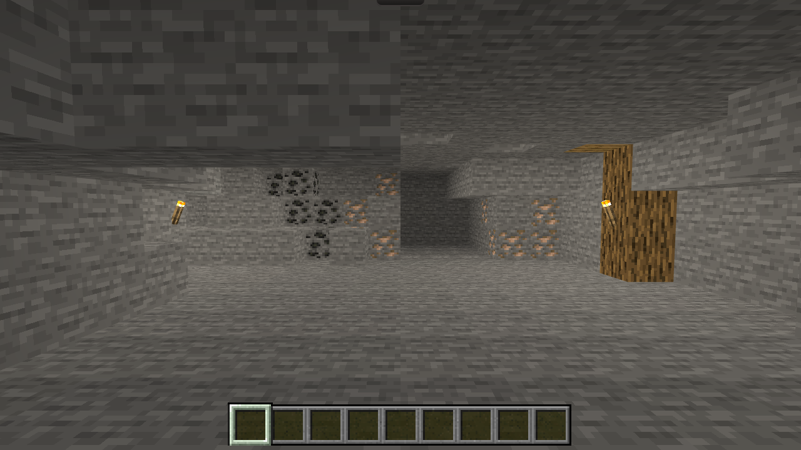

# 自然矿脉与岩壁采掘

2026-10-23。用户指出矿脉仍像陈列块，且绝大部分石头不能挖。本次以该最新要求覆盖附件中的原12来源数量限制；保留原有12个来源的ID、类型和坐标，以及设备、库存和采集事实。原[洞穴设计与交付](../cave/report.md)作为历史记录保留。

## 实施

- 左侧矿带由不齐的石肩、凸台和覆盖部分矿石的岩块连接起来；煤、铁沿侧壁及岩体内部延续，右侧另有错层铁矿露头。所有矿石都有真实采集身份，不使用装饰矿石。
- 内层两侧岩壁和低顶接入原版硬度、工具、持续长按、裂纹、破坏粒子、命中声和有限掉落；挖掉外层后，真实三维后层才暴露。不是点一下隐藏一张背景。
- 有限固定岩体共有1432块石头、13块煤矿、13块铁矿（含原12来源）。这些数字是整个固定体积，不能解释成固定眼位立即可见、可达的数量。原眼位、转向范围及不移动合同不变；地基、最外边界与木支撑保留为结构，不增加无限挖掘或世界生成。
- 新来源使用`rock:x,y,z`稳定ID。挖掘事实沿用现有`visits.cave.removed`，没有清档、重置库存或新存档版本。普通刷新、重复选择同场景不补回来源；离开再返回沿用既有访问恢复规则，已放设备优先占格。
- `caveLayout`根据挖空格只提交暴露表面，源模型在相邻挖掘时保留，避免为每块岩石重建整个矿洞。一次默认投影312个自然来源，不提交全部1458块的隐藏模型。
- 放置占用和下方支撑读取真实剩余来源；采空格允许合法设备。挖空位置的新设备不会免费清掉邻格。旧设备与新增石肩冲突时仍保留设备本身和视线通道。被设备遮蔽或兼容通道清出的石块不能被域命令暗中采集。
- 左侧火把的支撑石可挖；支撑消失后火把、占用和对应局部光同步撤除。右侧木支撑、薄火把不提供整格顶面支撑的规则不变。

体积边界、矿脉延续和石肩坐标属于依据用户自主执行授权作出的工程决定，并非声称用户逐项指定。未修改其他三个场景的布局；并行主页/设置清理提交`f91f924`完整保留。

## 真实运行与输入证据

正式构建原始截图，无裁切、补光、改图或假尺寸。三种浏览器视口为1280×720、1920×1080、390×844，DPR均为1；每张实际build、视口、样本条件见[截图清单](evidence/screenshots.json)。本地构建标识为提交前HEAD，源码包含本次工作区修改，最终上线build另行核对。

| 状态 | 1280×720 | 1920×1080 | 390×844 |
|---|---|---|---|
| 默认洞穴 | [截图](evidence/default-1280.png) | [截图](evidence/default-1920.png) | [截图](evidence/default-390.png) |
| 全部有限来源采空样本 | [截图](evidence/empty-1280.png) | [截图](evidence/empty-1920.png) | [截图](evidence/empty-390.png) |
| 已有熔炉样本 | [截图](evidence/devices-1280.png) | [截图](evidence/devices-1920.png) | [截图](evidence/devices-390.png) |

采空/设备状态是校验有效的受控存档样本，不冒充从零手工通关。竖屏另有原生右拖的[左侧](evidence/pan-left-390.png)和[右侧](evidence/pan-right-390.png)。

真实Chrome原生键鼠事件在普通游戏页完成：选铁镐、左键持续按住1800ms，依次采掉`rock:-5,1,3`和`rock:-5,1,2`，取得2个圆石；刷新后两个移除ID与库存保留。见[挖掘/刷新存档证据](evidence/native-mining-refresh.json)。

随后选熔炉，对露出的后层侧面右击，预览与提交均落在已挖空的`[-5,1,2]`；可以打开[熔炉GUI](evidence/native-mined-furnace-gui.png)，关闭、刷新后[设备仍保留](evidence/native-mined-placement.png)，见[提交存档](evidence/native-mined-placement.json)。这里的工具和设备由明确测试存档提供，实际操作通过浏览器输入完成。

[真实几何检查](evidence/geometry-1280.json)使用生产射线、原版模型/alpha与固定眼位转向：原12来源均可逐个露出并命中；当前表面剥离可命中304个对象。未把眼后/视域之外表面冒充可达。四种旧设备样本保留位置、内容和可见表面；6次Home/Cave重建的模型存活量稳定为318。几何剥离本身是测试控制，不等同于浏览器原生挖掘输入。

## 资源、缓存与验证

没有引入新的模型、状态或纹理。石头、煤矿、铁矿、木构件及两种壁挂火把状态复用锁定26.3资源；普通导出与清单继续包括父模型、纹理和动画依赖，SHA-256/字节数校验不变。`data:verify`通过，构建继续审计来源与资源哈希；不依赖外部缓存。

可复现脚本：`app/tests/cave-production.mjs`，第四参数可指定本报告证据目录。旧清单样本与其引用的历史`world-sounds.json`配套保留，历史声音文件由`6f9ce81`读取并核对旧清单SHA-256。第一次测试发现只注入旧清单、配新声音文件会先触发`resource-integrity`；补齐历史资源样本后继续验证真正完整的旧缓存升级，没有放松正式加载校验。

- Root和Pages子路径：先让真实Chrome HTTP缓存持有旧清单、旧资源及当前清单键；切换服务器版本，普通进入游戏与刷新均检查正式场景、HUD就绪和旧采集记录保留。证据：[root](evidence/root-cache.json)、[Pages](evidence/pages-cache.json)。
- 独立故障注入：坚持提供旧清单与相配资源，显示具体`world-model:wall_torch…`失败；恢复当前资源后普通刷新恢复，不清除站点数据或存档。证据：[root](evidence/root-failure-recovery.json)、[Pages](evidence/pages-failure-recovery.json)。
- TypeScript、正式root/Pages构建与产物审计通过；规则全套667项、P2原型48项、正式HTTP双路径2项通过。新增回归覆盖连续三层暴露/挖掘/圆石掉落/保存、采空位置设备不免费清邻格、火把支撑消失、固定来源唯一性及隐藏矿脉延续。

原生浏览器输入、受控存档、几何断言和故障注入分别记录。没有操作实体电脑或启动Java客户端；人工声音听感、用户目标浏览器和实体输入体验不冒充已验。提交、普通快进推送、CI、部署及线上build的最终结果在交付回复中另报。
