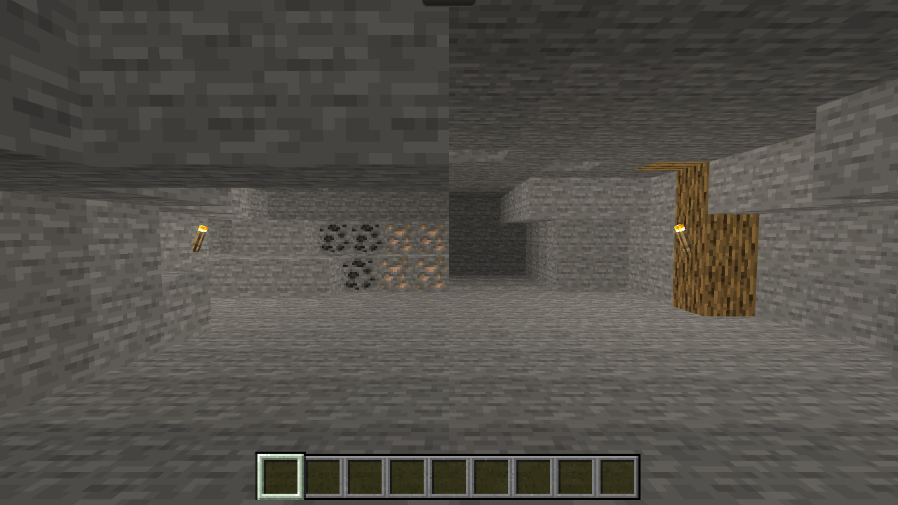

# 洞穴场景改造

2026-10-23。按用户附件[设计交接](design.md)实施；附图只作构图、材质与明暗参考，运行画面全部由实时 Three.js 场景生成。实施从当前分支开始，没有检出附件中的历史 SHA。保留并行的快捷栏取得顺序提交 `4a05e46`，不改造 Plains、Farm、Home 或生日主页。

## 画面与空间

- 保留固定眼位 `[0,1.62,7]`、默认目标 `[0,1,-5]`、水平 ±36°、俯仰 ±15° 和既有横竖屏 FOV；没有新增移动或距离门槛。
- 入口仍以 2–3 格净高为主，左侧低顶与侧壁不对称退让；左前来源后方增加有厚度的石肩和低台，采完后留下岩体凹口。右工作袋连续且初始空置；深部真实石壁向左折入暗处，没有黑色封口平面。
- 原 12 个来源的 ID、同类顺序、坐标和类型完全不变。未添加不可采的装饰矿石。自然来源继续由 `AuthoredWorld.natural` 和原 `node:` 射线身份管理。
- 固定壁挂火把位于 `[-6,1,-2]`（east）与 `[4,1,-1]`（west）；右外墙使用 3 个橡木原木和 1 个可见木板梁单元替换石壳，另一个梁候选位于埋藏层，不提交不可见几何。

上述锚点、入口退让与光衰减属于**依据用户自主执行授权作出的工程决定**。经过实际画面与生产射线验证选择，不将参考图换算成坐标，也不将作者调参声称为用户逐项指定。

## 局部照明与设备兼容

`render/cave-lighting.ts` 以世界坐标计算两支火把的暖色衰减和深处环境光。石壳/地面/木构件使用实例色，自然来源和设备使用各自拥有的顶点色；原有原版朝向面色仍参与结果。保留原色，重新应用时从原色计算，签名不变时跳过。没有改为 PBR、添加无效 PointLight 或全屏黑色蒙版。

`applySkyLighting` 在 cave 中仍恢复共享材质的中性原色；局部光留在实例/顶点属性，不会被每帧覆盖，也不会把其他场景和 GUI 染黄、染暗。火把使用原版静态亮纹理；没有新增动态阴影、粒子光效或额外动画循环。

石壳、木支撑、火把与光源由同一个 `caveLayout` 投影。旧设备在新增实体内时，继续保留邻域和眼位通道；冲突的火把、被移除墙面所承载的火把及对应光源共同退出。正常邻接设备不撤掉不冲突的火把。设备的 ID、坐标、朝向与内容不写回、不迁移。

薄火把保留实际原版 alpha/模型射线，但 `support=false`，也不进入完整方块支撑判断。其占用同时进入预览和最终命令；即使下方确有设备支撑，向火把单元放设备仍拒绝。木支撑只替换已有石壳单元，不新增整片禁建区。已采空来源区域继续允许合法设备，返回恢复来源时设备优先占格。

## 真实运行截图

以下为普通发布构建的原始 PNG，未编辑、补光、裁切或缩放；浏览器报告的视口和 DPR 见[截图清单](evidence/screenshots.json)。均为 DPR 1。默认样本是初始空洞穴存档；采空和已有设备样本通过合法校验的受控存档加载，明确不是从零通关证据。

本地构建在洞穴提交前生成，真实 build 标识为当时 HEAD `4a05e461981a`，内容包含本次工作区改造；该标识不表示旧线上 `4a05e46` 已有洞穴改造。最终推送后的线上 build 另行核对。

| 状态 | 1280×720 | 1920×1080 | 390×844 |
|---|---|---|---|
| 默认 | [截图](evidence/default-1280.png) | [截图](evidence/default-1920.png) | [截图](evidence/default-390.png) |
| 采空 | [截图](evidence/empty-1280.png) | [截图](evidence/empty-1920.png) | [截图](evidence/empty-390.png) |
| 已有熔炉 | [截图](evidence/devices-1280.png) | [截图](evidence/devices-1920.png) | [截图](evidence/devices-390.png) |

窄屏沿用既有视角策略，默认无法同时容纳横向两支火把；使用原生右键拖动，在同一固定眼位查看[左采矿区](evidence/pan-left-390.png)与[右工作袋](evidence/pan-right-390.png)。截图清单记录实际 yaw/pitch，不用拉宽画面模拟横屏。

## 实际输入与几何验证

| 项目 | 本次证据 |
|---|---|
| 三尺寸生产射线 | 各 12/12 来源逐层可达、零失败；使用真实原版模型、alpha、遮挡及 `SceneView.pick`。[1280](evidence/geometry-1280.json)、[1920](evidence/geometry-1920.json)、[390](evidence/geometry-390.json) |
| 未采/部分/全部 | 三尺寸各验证 12、6、0 个剩余来源；采空后岩体保留 |
| 原生采矿 | 明确提供有限铁镐的隔离样本，浏览器原生长按逐一采完全部12来源，刷新后 removed 仍为12。[操作记录](evidence/native-mining.json)、[部分采空](evidence/native-partial.png)、[采空](evidence/native-empty-1280.png) |
| 四类设备 | 有限材料样本中，原生右键在 `[3,0,0]` 放置、打开，R旋转，原生长按拆除。[熔炉记录](evidence/native-furnace.json)、[其他三类](evidence/native-other-devices.json) |
| 原版设备 GUI | [工作台](evidence/native-crafting_table-open.png)、[熔炉](evidence/native-furnace-open.png)、[高炉](evidence/native-blast_furnace-open.png)、[漏斗](evidence/native-hopper-open.png)；界面未受洞穴色彩污染 |
| 刷新/跨场景 | 规则与真实鼠标切场景分别核对；重复选择不补货，刷新不补货，跨场景后 Cave epoch 增长并补货。[实际返回](evidence/native-reentry.json) |
| 旧炉 | `[-5,0,1]`、身份与3原木输入保持，三尺寸生产射线可达；另测矿物原单元设备和与木柱/火把冲突的旧炉，恢复后无源/设备重叠。属于受控几何/存档检查，不声称这几个旧档均由原生鼠标打开 |
| 邻接网络 | 右工作袋 `[3,0,0]` 熔炉、顶部 `[3,1,0]` 漏斗及侧边 `[4,0,0]` 漏斗通过实际放置规则；原生规则 tick 完成上输入/侧燃料传输、点火和加工，有限组语义保留 |
| 生命周期 | 每个尺寸6次 Home↔Cave 重建，模型存活计数均保持18；原色重算、光源移除/恢复、共享材质不变有专项回归。不是无限运行无泄漏或低端设备性能保证 |
| 其他场景 | 实际切换 [Plains](evidence/regression-plains.png)、[Farm](evidence/regression-farm.png)、[Home](evidence/regression-home.png) 后再回 Cave；未修改其布局与材质 |

几何夹具通过允许的角度设置相机并剥离模型，与上表浏览器原生鼠标输入分开。设备样本不是从零合成取得四种设备的通关演示。未操作实体电脑、未启动 Java 客户端；用户目标浏览器、实体鼠标/触摸屏、人工试听、跨引擎和 OS 后台项仍由后续人工验证。本次 headless Chrome 观察到真实 Pointer Lock 成功，设备与采矿证据采用可见自由指针；这不代表全部隐藏模式边界已专项复验。

## 原版资源与旧缓存

从锁定官方 26.3 client.jar 只读提取，SHA-1 `e877b6a07acd633fb3bb475002175cec036e7b87`，不执行客户端。新增3个原始文件：`blockstates/wall_torch.json`、`models/block/wall_torch.json`、`models/block/template_torch_wall.json`。复用已存在的 `textures/block/torch.png`；原版模型旋转和透明采样沿用现有管线。导出器登记4个原版朝向、完整父链/纹理输入、字节数、SHA-256及导出器自身哈希。资源总集合由838变为841项。

清单仍统一通过 `fetchManifest` 的实际 `?build=` 参数和 `cache:'no-cache'` 请求，不改弱完整性检查。保存[改造前清单](../../../app/tests/fixtures/world-manifest-before-cave.json)作为可复现样本。

真实 Chromium HTTP 缓存测试由普通 HTTP 服务提供旧清单和可缓存原资源，先确认浏览器实际命中旧清单缓存，再切换服务端清单；不是 Playwright route 替换，也不清浏览器缓存。原始 URL、前一发布参数及当前构建参数均预热，覆盖构建参数分离与同键重新校验。正式根路径、Pages 子路径均达到 `boot=ready`、`inventoryReady=true`、正式 Cave 已渲染，普通刷新保留6个采空事实。

- [根路径旧缓存与刷新](evidence/root-cache.json)、[根路径画面](evidence/root-cache-upgraded.png)。
- [Pages旧缓存与刷新](evidence/pages-cache.json)、[Pages画面](evidence/pages-cache-upgraded.png)。
- 独立故障注入：向新代码提供旧清单，真实报错 `world-model:wall_torchfacing=east`；恢复服务端清单后普通刷新即可恢复，无清档/清缓存。[root](evidence/root-failure-recovery.json)、[Pages](evidence/pages-failure-recovery.json)。故障注入不是对用户浏览器缓存的读取。

## 工程检查与复现

- `npm run check`：[日志](evidence/check.log)。
- `npm test`：608/608，包括本轮6项洞穴回归、1项缓存回归及并行快捷栏回归。[日志](evidence/tests.log)。
- P2保留技术回归48/48：[日志](evidence/p2-tests.log)。
- 数据与哈希核验：[日志](evidence/data-verify.log)。
- root / Pages 普通构建与公开产物审计：[root](evidence/build-root.log)、[Pages](evidence/build-pages.log)。
- 两路径 HTTP 与资源原始字节2/2：[日志](evidence/built-http.log)。

几何复现：`npm run dev:verify` 后访问 `/__verify__/cave.html`，调用该隔离页的 `caveTest.audit()`，可用 `caveTest.show('legacy')` 等显示受控样本。该页由 verification 模式限定，普通构建不包含。

生产/真实缓存复现：先普通构建两种路径，再运行 `node --experimental-transform-types tests/cave-production.mjs <Playwright包目录> <Chrome可执行文件>`。脚本只建立新的隔离浏览器上下文。导出复现：`node --experimental-transform-types tools/world-assets.ts --client <已验证client.jar>`。

主要修改集中在 `domain/cave-shape.ts`、`render/cave-lighting.ts`、`AuthoredWorld` 洞穴分支、`SceneView.syncWorld` 的洞穴设备颜色接线及动态占用/支撑判断。存档编码、来源顺序、采集经济与其他场景实现未改动。提交、快进推送、CI构建、Pages部署与线上实际build的最终结果在交付回复分别报告。
