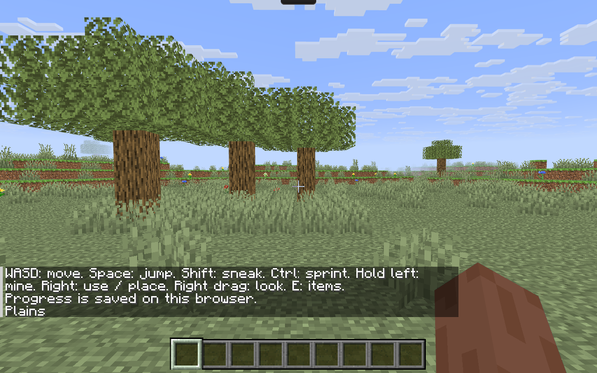

# 隐藏鼠标模式的连续转向

用户明确跳变发生于隐藏鼠标、中心准星模式。本次仅调整共用输入层，保留自由移动、四场景布局、采集/放置、资源和全部存档。

## 实现与依据

- Pointer Lock 优先请求 `unadjustedMovement: true`；仅 `NotSupportedError` 自动回退普通锁定。权限拒绝不重复申请。Promise 与错误事件合并处理，暂停、失焦、卸载和迟到锁定仍受代次保护；旧浏览器的 void 返回接口继续按实际事件确认。
- 锁定转向只消费 `mousemove.movementX/Y`；可见鼠标拖动仍使用 PointerEvent。两个事件流不会重复累计；绝对指针坐标及伴随 PointerEvent 的位移不会改变锁定视角。水平角度连续累计，保留快速大幅转动与上下观察极限。
- 锁定的 Java 26.3 client SHA-1 为 `e877b6a07acd633fb3bb475002175cec036e7b87`。只读提取 `MouseHandler`：`onMove` 在抓取状态累计 SDL `xrel/yrel`，非抓取状态才计算坐标差。没有启动 Java 客户端。浏览器 API 的选用属于依据用户自主执行授权作出的工程决定，不声称 Java 使用网页 API。
- [MDN Pointer Lock](https://developer.mozilla.org/en-US/docs/Web/API/Pointer_Lock_API)说明原始相对输入及不支持时的回退；[Chromium 事件处理源码](https://chromium.googlesource.com/chromium/src/+/refs/heads/main/content/browser/renderer_host/render_widget_host_view_event_handler.h)区分普通锁定的光标居中路径与 Windows WM_INPUT 原始输入。与用户症状相似的[Chromium 窗口边缘跳变记录](https://issues.chromium.org/issues/40737979/blocking)作为排查线索，不能证明用户设备上的根因。

## 验证

- 正式测试全套 690 项通过；随后补充的旧浏览器成功/失败事件测试均通过（当前总计 692 项）。保留 P2 测试 48 项、数据完整性校验、root/Pages 普通构建及审核、两条 HTTP 路径与资源字节检查全部通过。
- [可复现浏览器脚本](../../../app/tests/locked-look-browser.mjs)在独立 Chrome headless 配置中发出真实浏览器鼠标和键盘输入，没有用 DOM 合成事件代替该项验证。root 与 Pages 均确认实际锁定、原始输入请求、世界/HUD 就绪、零页面错误。
- 每条路径分别执行 ±30、±120 像素各 80 次输入：累计转角分别为 ±7.2、±28.8 弧度，与浏览器实际收到的相对位移逐批匹配。四个朝向按 W 均沿当前前方向移动；Esc 后移动鼠标不改变视角；刷新恢复同一位置/角度，再次锁定可继续转动。
- [root 结果](evidence/root/results.json)、[Pages 结果](evidence/pages/results.json)及两张 1280×800 原始截图随文保存。构建标签 `80471db5afbe` 是本地修改尚未提交时的基线 SHA，不代表线上已经包含修正。
- CPU 回归单独注入异常的伴随 PointerEvent 位移，确认不会污染 MouseEvent 转角；该项是隔离故障测试，不冒充物理鼠标复现。

## 验证边界

修正前的 headless 浏览器连续转身检查未复现用户的突然反向；本次修正了可能触发该症状的输入路径，但不能据此宣布用户实体鼠标/Windows 边缘重定位问题已经实测消失。未操作实体桌面，未伪造物理输入验收。场景资源、清单及导出内容未变；发布后在保留旧页面缓存与保存进度的浏览器上下文中检查正常刷新升级，发布结果另随交付记录。

