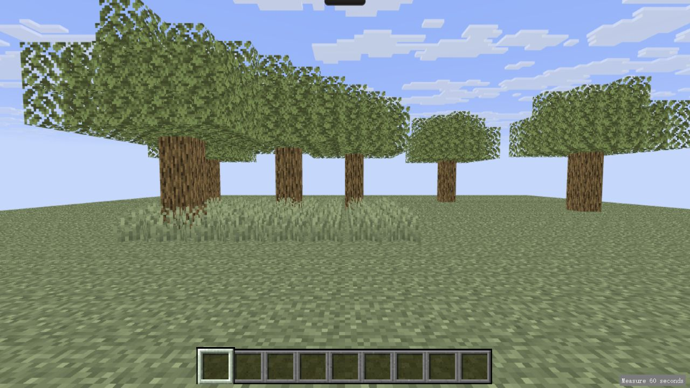
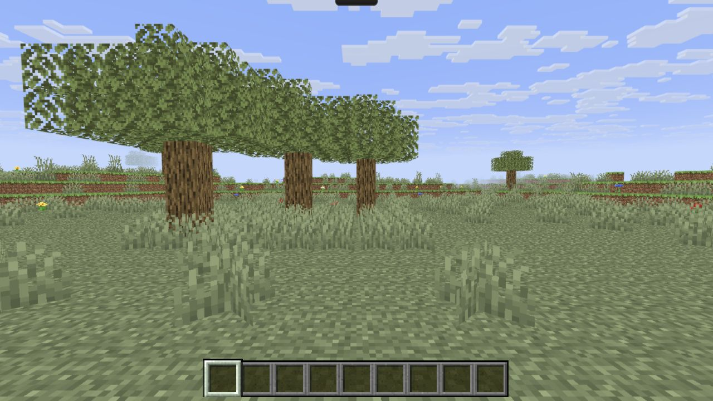

# Plains 草原视觉升级

2026-10-23。基线为 `971a027`，本次仅重设计 Plains。保留 Cave、Farm、Home、生日主页、资源经济、33 个草原资源节点及存档结构。

## 构图与地形

左侧至中央保留三棵可采集橡树的原坐标，冠层采用不同缺角、偏移和层形；中央留开阔草地，右侧保留工作站操作空间。周围以 1–3 格低丘、阶地、少量露出泥土的浅洼及六棵稀疏远景橡树围合地平线。没有房屋、村庄或农田，也没有新增移动、世界生成或可采集装饰资源。

眼位 `[0,1.62,7]`、默认朝向和既有转向范围不变。完整原可建造范围 `x=-18…18,z=-22…10` 的地面高度仍为 0，以兼容任何已有地面工作站；地形起伏在此之外自然衔接。有限作者地形延伸至约 144 格半径，使用原版单位 Grass Block/Dirt 的可见面，非拉伸平面或背景图。Plains 独立的 44–68 格距离雾使用现有天空实时雾色，随日夜、雨雷变化；其余场景没有新增距离雾。

这些布局、散布密度和距离属于**依据用户自主执行授权作出的工程决定**。参考 [Minecraft Wiki 的 Plains 描述](https://minecraft.wiki/w/Plains)中开阔草地、稀疏橡树及零星野花的特征；用户提供的图片仅作参考链接，没有进入运行资产。Sportskeeda、旧 Wikia 图片在网页读取工具中不可达，未将其记为已完成图像逐像素对照。

无设备初始布局含 1228 株装饰短草、53 株双格高草、88 株花（蒲公英23、虞美人18、滨菊15、矢车菊20、蓝花美耳草12）。分布由固定坐标散列和手工设计的疏密区决定，每次刷新一致。植被使用原版交叉面模型及原有像素、alpha、草/叶染色流程，花朵不被草地染色。

## 真实前后对比

截图均为浏览器原始 JPEG，未绘制、拼接、调色或缩放。基线截图带既有性能观察按钮；后图来自普通根路径生产构建。

改造前（1280×720）：

改造后（1280×720）：

其他普通生产构建尺寸：[1440×900](evidence/after-1440.jpg)、[390×844](evidence/after-390.jpg)。完整尺寸通过浏览器 full-page 捕获取得；工具的可见区域截图曾受侧栏裁切，最终文件按 JPEG 实际尺寸核实，没有把裁切图冒充指定分辨率。

## 拾取、保存与生命周期

- 原有 `oak_log:0…8` 和 `short_grass:0…23` 的坐标、身份、消耗、掉落、刷新及跨标签事务不变；纯视觉橡树、花草没有注册成来源。
- 草花、冠层和区域外地形在 Three.js render-only layer 1；游戏摄像机显示该层，正式射线仅检测 layer 0。装饰不会先抢到命中后再侥幸过滤。实际自然节点、原有合法地面及设备仍按原版模型射线与 alpha 判定。
- 三棵近景树没有新增静态树干覆盖。某树三个原有原木节点全部采集后，该树冠消失；部分砍伐仍显示尚未采集的原有原木，遵循原本逐块采集语义。切换场景补货后恢复。
- 草花避让自然节点和设备周围一格，树叶避让设备占用格。旧静态树冠位置不再形成不可见碰撞。已有高位工作站若依赖原树木装饰支撑，按其保存坐标投影不可采集原木支柱；不移动或删除设备、不改其内容，设备拆除后对应支柱随之释放。这一兼容投影不授予物品，也不写入额外存档字段。
- 地形按露出面与原版材质分组实例化，保留草侧面覆盖层；埋藏面不提交。65,070 个表面单元由20种面组合描述。通用 batch 遍历所有 mesh 部件并保留其变换，不再假定只有第一个子 mesh。
- 场景释放同时处理 InstancedMesh 实例缓冲和自有 geometry；材质/贴图继续由原共享工厂释放。雨的高度图排除草花，保留地形、树冠及设备遮雨。

## 原版资源

复用现有 Grass Block、Dirt、Oak Log、Oak Leaves、Short Grass。新增 **26 个同版本原始文件**：Tall Grass 两半状态/模型/纹理、五种野花状态/模型/纹理及其 mcmeta、共享 `cross` 父模型。具体路径、字节数、SHA-256 见 [world-manifest.json](../../../resources/minecraft/26.3/world-manifest.json)。全部资源集合由812增加到838项（含清单）。

来源为锁定的 [Mojang Java 26.3 官方 client.jar](https://piston-data.mojang.com/v1/objects/e877b6a07acd633fb3bb475002175cec036e7b87/client.jar)，SHA-1 `e877b6a07acd633fb3bb475002175cec036e7b87`。只读已有 JAR，未启动 Java 客户端。复现：`node --experimental-transform-types app/tools/world-assets.ts --client <verified-client.jar>`。导出器同时维护模型父链、原版状态、依赖哈希及自身哈希；普通开发、根构建、Pages 构建均使用提交资源，不依赖本机 JAR。

## 验收证据与边界

| 检查 | 实际结果 |
|---|---|
| 普通游戏原木 | 浏览器原生左键按住4.2秒采集 `oak_log:1`，背包增加1原木；[记录](evidence/native-log-harvest.json) |
| 普通游戏草丛 | 原生点击采集 `short_grass:12`，removed 与随机 roll 正常推进；该次按既有规则没有种子掉落，[记录](evidence/native-grass-harvest.json) |
| 工作台完整链 | 用上述1原木实际合成4木板、再合成工作台，移入快捷栏，右键放置于 `[5,0,-3]` 并打开；[放置](evidence/native-table-placed.jpg)、[界面](evidence/native-table-open.jpg) |
| 刷新/拆除 | 刷新保持相同实例ID、位置及资源采集事实；长按拆除后实例为空。[恢复](evidence/native-table-restored.json)、[拆除](evidence/native-table-removed.json) |
| 炉/漏斗 | **明确有限物品测试夹具**提供各1设备和铁镐，随后均用真实浏览器右键放置、打开和长按拆除；R使炉转为west。不是普通采矿/炼铁通关证据。[记录](evidence/fixture-devices.json)、[炉](evidence/fixture-furnace-open.jpg)、[漏斗](evidence/fixture-hopper-open.jpg) |
| 场景切换 | 实际点击 Cave→Farm→Home→Plains，草原 epoch=1、removed=[]，正常补货；各自画面保持原场景构图 |
| 其他场景/主页 | [Cave](evidence/cave-regression.jpg)、[Farm](evidence/farm-regression.jpg)、[Home](evidence/home-regression.jpg)、[生日主页生产构建](evidence/birthday-home-regression.jpg) |
| 三尺寸环境 | 1280×720、1440×900、390×844 各保存默认/左极限/右极限/夜间/降雨，共15张原始截图；逐张检查无矩形边界或浮空地形。姿态、实际视口、时间/天气记录见 [矩阵](evidence/visual-matrix.json) |
| 实际几何可达 | 浏览器内生产射线与模型检查：Plains 33 个资源目标、满布局126个设备逐层可达，均零失败；Cave/Farm/Home对应75/45/40个设备也可逐层移除。[原始记录](evidence/spatial-access.json)。这是夹具调整相机并剥离几何的检查，不冒充实际鼠标逐个拆除，也不证明任意异构布局 |

环境矩阵使用真实浏览器、生产 SceneView 和标明 TEST 的显示控制；它设置既有±36° yaw、夜间/降雨样本，不冒充实际鼠标右拖或自然等待天气。文件以 `matrix-{宽度}-{default,left-limit,right-limit,night,rain}.jpg` 命名。窄屏因原有投影视野展示更窄区域，不修改出生位或摄像机参数。

当前 IAB 对 Pointer Lock 请求实际失败，已确认回退至可见指针且采集/放置可用。真实锁定、实体右键拖动、触屏操作、跨引擎/低端设备、OS后台、人工音频试听和 Java 客户端人工对照未验证。既有规则测试不替代这些缺口。本次没有操控实体电脑。高炉沿共享设备路径及原有自动测试覆盖，本次未另做高炉鼠标专项操作。

## 自动检查

- `npm run check` 通过。
- 正式 `npm test` **585/585**（新增6项覆盖确定性地形、所有旧地面、原版植物两半与 tint、可见面 UV、真实几何射线与树冠生命周期、多部件/实例释放及旧高位设备支撑）。[完整日志](evidence/tests.log)
- P2 保留技术回归 **48/48**。[日志](evidence/p2-tests.log)
- 原版数据核验：113物品、112可达配方、2042分类、18步蛋糕链及导出器哈希通过。[日志](evidence/data-verify.log)
- root / Pages 构建、资源字节与公开产物隔离审核通过。[root](evidence/build-root.log)、[Pages](evidence/build-pages.log)
- 两种正式 HTTP 路径及全部资源字节 **2/2** 通过。[日志](evidence/built-http.log)

## 性能

同一 IAB、1280×720、DPR约1、空设备布局，均预热5秒并测量60秒；前后均未观察到visibility变化。下表为实际观测，不推断低端设备表现或声称提升帧率。

| 指标 | 改造前 | 改造后 |
|---|---:|---:|
| RAF间隔 p95 | 4.3ms | 4.3ms |
| CPU提交 p95 | 1.10ms | 1.20ms |
| GPU计时 p95 | 2.37ms | 2.59ms |
| 帧间隔峰值 | 37.6ms | 37.5ms |
| 观测末帧 draw calls | 53 | 101 |
| 观测末帧三角形（包含既有云天空） | 660,098 | 790,142 |
| renderer几何数 | 39 | 66 |

原始 [前测](evidence/performance-before.json)、[后测](evidence/performance-after.json)及[摘要](evidence/performance-summary.json)保留。原先545.6ms峰值的原因仍未确定，本任务未对此补写原因。场景资源释放有生产类多次重建/销毁测试；不把有限次数测试表述成无限运行无泄漏证明。

## 文件变更与交付

- `app/web/src/domain/plains-shape.ts`：有限地形高度、树冠、植被及保存设备支撑。
- `app/web/src/render/plains-terrain.ts`：原版露出面筛选与地形分批。
- `app/web/src/render/authored-world.ts`：Plains装配、源状态树冠、植物避让、多部件实例及释放。
- `app/web/src/render/scene.ts`：显示层与Plains动态雾色；原拾取输入实现未更换。
- `app/web/src/render/native-precipitation.ts`：植物不作为遮雨实体。
- `app/web/src/domain/world-config.ts`：显示装饰与真实支撑/占用一致；原节点与合法地面不变。
- `app/tools/world-assets.ts`、`world-manifest.json`及26个资源文件：准确同版原始资产。
- `app/tests/plains.test.ts`、两个资源数量断言及环境/设备测试夹具：有意义的回归及浏览器可复现操作。
- `AGENTS.md`及本目录：最新项目约束和可审计证据。

只创建普通新提交并向现有main作快进推送；不进行历史重写。报告与截图封存后，提交标识、远端、CI、部署和线上build分别在交付对话中核对，避免把候选源码中的基线build标签误当最终提交号。
