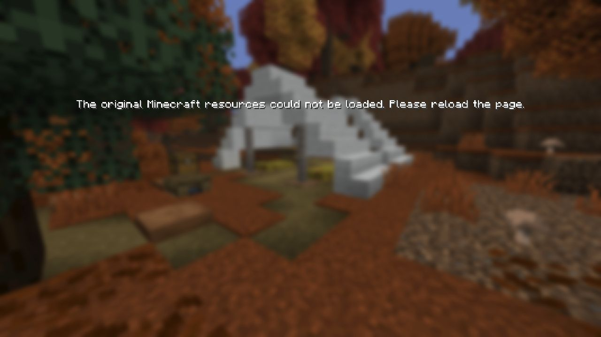
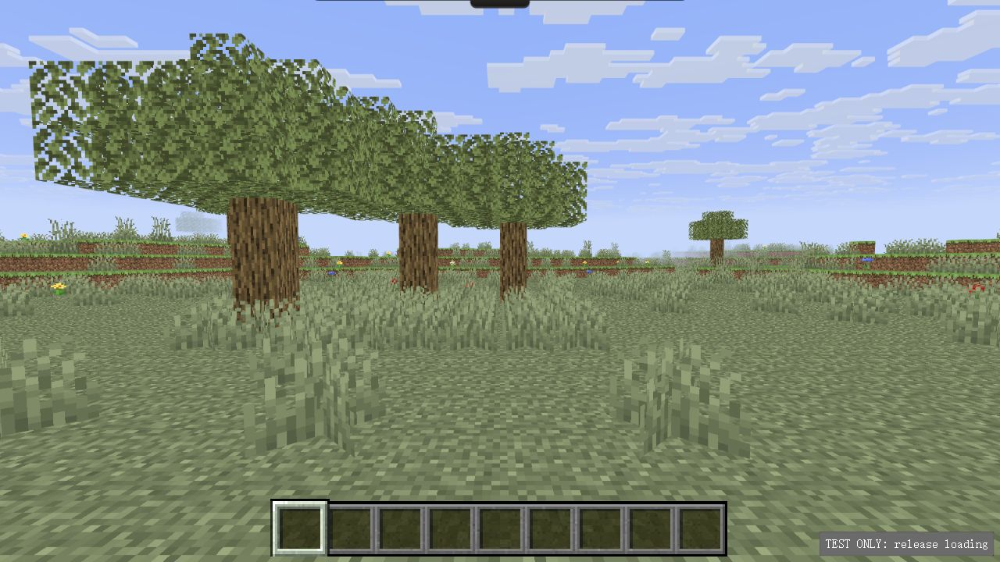

# 原版资源清单缓存修正

2026-10-23，基线 `5beabff71dbf`。用户在 Chrome/Edge 刷新后仍停留在原版加载失败画面，提供的实际诊断为 `world-model:tall_grasshalf=lower`。

## 原因与实现

Plains 代码需要新增高草和野花，但运行清单仍使用不带发布版本的固定 URL。旧 `world-manifest.json` 仍声明同一个 Java 26.3/client SHA-1，因此能通过既有版本检查，却没有高草状态；构建草原时找不到 `tall_grass half=lower`。此前干净浏览器的首次加载没有覆盖这一更新路径。

使用上一次发布 `971a027` 的真实清单，在当前生产 AuthoredWorld 和真实浏览器 mount 中均复现了用户提供的完全相同错误。未读取用户浏览器 HTTP 缓存，故不声称直接抓取到了其缓存条目；这里的证据是用户错误码、资源清单差异及可复现故障路径。

- 新增轻量 `render/resource-fetch.ts`，原版启动、世界及图鉴清单统一使用 `?build=<实际构建提交>`，并以 `cache: 'no-cache'` 要求重新校验。
- 图片、模型等原始资源继续使用既有 URL 和 SHA-256/字节数验证，不改原版文件、不取消完整性校验、不用缺省模型掩盖失败。
- 不修改存档、资源经济、场景坐标或任何用户设置；无需清除站点数据。
- 原测试夹具按 URL pathname 匹配屏障，版本参数不再绕过既有加载等待/失败检查。

## 验证

- 三项新增自动测试：旧清单准确复现报错；新请求绕开固定 URL 的旧缓存并要求重新校验；HTTP/网络故障仍保持失败。
- 工作区完整 `npm test`：590/590，含另一项并行工作的2项降雨测试。本修复自身相对585基线增加3项；并行降雨文件未纳入本修复提交。[日志](evidence/tests.log)
- `npm run check`、数据/哈希校验、root 与 Pages 构建、两种 HTTP 路径资源检查通过。[数据](evidence/data-verify.log)、[root](evidence/build-root.log)、[Pages](evidence/build-pages.log)、[HTTP](evidence/built-http.log)
- 真实浏览器夹具保留旧缓存：旧请求命中1次并出现同一错误；版本化请求命中旧缓存0次，正式场景/HUD就绪，加载资源释放断言全部通过。[旧请求](evidence/legacy.json)、[修复后](evidence/fixed.json)
- 注入真实503响应，键盘释放等待屏障后仍显示资源失败，未暴露未就绪控件。[记录](evidence/network-failure.json)
- 普通生产 root 和 Pages 子路径均达到 `boot=ready`、无 `resourceError`。[root状态](evidence/root.json)、[Pages状态](evidence/pages.json)、[root截图](evidence/root.jpg)、[Pages截图](evidence/pages.jpg)

旧清单错误复现（原始浏览器截图）：

保留旧缓存、版本化请求后（原始浏览器截图）：

上述旧缓存响应替换仅存在于标明 TEST 的隔离页，不进入普通发布。普通 root/Pages 页面另行检查；最终远端 CI、部署及线上 build 在交付时分别核对。用户原 Chrome/Edge 页面的实际刷新结果仍需用户确认，未操控实体电脑或清除其数据。

## 修改文件

`app/web/src/render/resource-fetch.ts`、`render/resources.ts`、`ui/icons.ts`、`ui/loading-screen.ts`；`app/tests/resource-cache.test.ts`、`startup-browser.ts`及历史清单测试样本；本报告与证据。工作区既有降雨方向改动保留，不混入本次提交。
